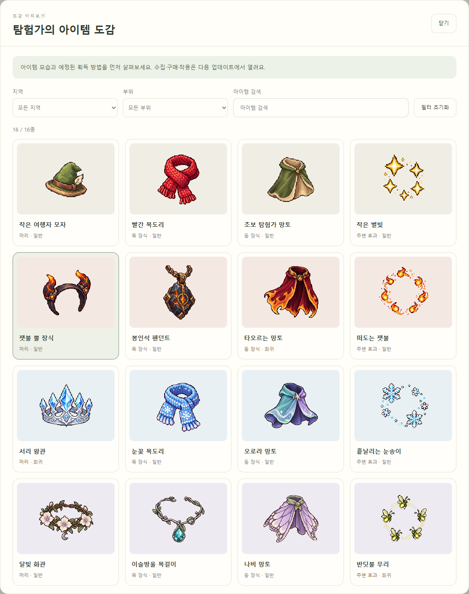
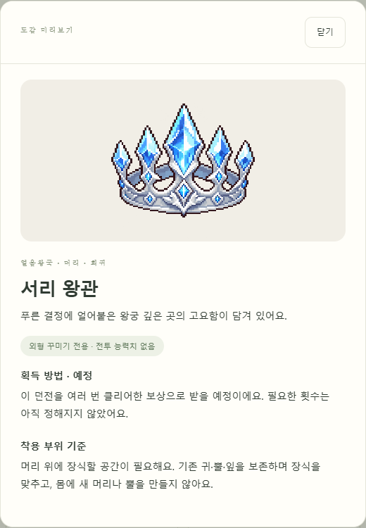
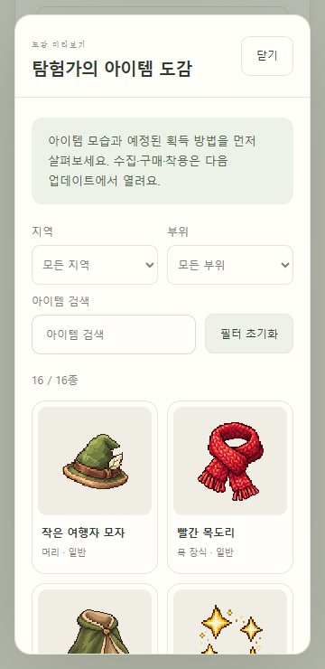

# Notebook Pets · Notebuddy

[한국어](README.md) · **English**

**Draw a little friend. Care for them, talk to them, and go on adventures together.**

Notebuddy is a companion game about growing alongside one AI friend. Start with a drawing, a photo or a surprise companion. Share your day, build a routine, discover stories and pixel dungeons on walks, and keep a little album of your friend's growth.

The current Anna owner test app is **0.10.0** (JRPG notebook theme and title screen). Version **0.8.1 is awaiting store review**; the app is not publicly released yet. This guide reflects the features available on October 14, 2026.

  

*Meet Mori: the actual companion Anna generated from the sprout drawing below.*

[Create a friend](#a-little-friend-from-your-own-drawing) · [Care and conversation](#share-a-meal-and-the-story-of-your-day) · [Growth album](#keep-their-growth-in-an-album) · [Walks and dungeons](#choose-what-happens-on-your-walk) · [Item book](#meet-sixteen-little-treasures) · [User guide](anna/README.en.md)

## A little friend from your own drawing

Sketch with a mouse or touch, or upload a drawing or photo you already have. Give your companion a name and choose Meet. AI looks at the reference's shape, colors and features, then creates a new character portrait.

| The original drawing | Mori, created from that drawing |
| :---: | :---: |
|  |  |

- **Draw it yourself:** use colors, an eraser and undo to sketch your friend.
- **Bring a drawing or photo:** use a PNG, JPEG or WebP image as a reference.
- **Meet a surprise companion:** start with one of 9 species and 8 elements without preparing an image.

Uncertain interpretations ask for confirmation before generation. If generation fails, you can retry for the same companion. AI creates a new interpretation of the reference, so the result can vary.

See the drawing editor

  

## Share a meal and the story of your day

Feed your friend, offer a treat, play, train and help them rest. Watch their fullness and bond, collect a daily gift, and finish daily quests for rewards.

Tell them about your day in the conversation area. Replies draw on their saved personality, recent conversation and shared experiences. They also offer a short reaction after care.

**Personality grows with experience.** A name and appearance inspire their initial voice and habits. Care, training, walks and adventure choices gradually influence curiosity, warmth, energy and caution. You can inspect these changes in the personality panel and hear them reflected in conversations and walk stories. Chat text alone does not directly change trait scores.

## Keep their growth in an album

Your little companion reaches new growth stages at **levels 10, 30 and 50**. When you are ready, request a new portrait and keep it beside earlier stages in the growth album. New growth portraits are generated when you choose to create them.

  

A **pixel version** is prepared from the completed portrait, so your own friend's appearance can join dungeon adventures. Pixel conversion itself makes no additional AI request.

## Choose what happens on your walk

A walk might bring an XP discovery, another creature, or a story with two choices. Pick what your friend does and see the outcome.

There are currently **six three-chapter story arcs**. Earlier choices and care/adventure experiences influence later events, preparation requirements and endings. Close a pending story and return through **Continue walk** when you are ready.

Walk charges currently recover **one every five minutes, up to five**.

## Discover three pixel dungeons

Dungeons can appear by chance during a walk. A discovery stays open for **24 hours**, with a countdown on screen. Another dungeon will not appear until the current one is cleared or expires.

| Dungeon | What awaits |
| --- | --- |
| **Hellgate** | Embers, lava and a journey toward a sealed gate |
| **Ice Kingdom** | A frozen kingdom surrounded by snow and ice |
| **Dream Forest** | A woodland filled with strange light and dreams |

  

*Hellgate before entry. The Mori from the home screen appears here as the same friend's pixel portrait.*

Your companion moves automatically as the camera follows. Explore **3–6 rooms**, choose your way through forks and traps, find recovery opportunities on longer expeditions, and challenge the final guardian. Before entering, you can check species adaptation bonuses and elemental matchups.

Each stage costs one walk charge. Your first clear of each region per day awards 10 coins. You choose when to enter the next stage; movement playback supports pause, 3x speed and skip.

## Meet sixteen little treasures

**The item book arrived in 0.9.0.** Choose **Browse items** on the home screen to see four items each from everyday adventures, Hellgate, Ice Kingdom and Dream Forest. You can browse before creating a companion, too.

  

Filter by region or type, search by name, and open a design to see its art, story, rarity, **planned way to collect it** and attachment requirements. Discover the Little Traveler's Hat, Frost Crown, Butterfly Cape, Firefly Companions and more.

| Item details | On a narrow screen |
| :---: | :---: |
|  |  |

**This is a catalog preview.** Collecting, buying and equipping are not available yet; prices and reward milestones are still undecided. Browsing spends no coins or AI allowance. The screenshots show Korean; the book also supports English.

Future equipment will take each companion's body shape into account. A friend without hands may collect gloves, but wearing gloves will not invent hands. Ornaments such as floating starlight are planned to work without limbs.

## Where can I use it?

| Edition | Availability |
| --- | --- |
| **Anna app** | The screens and features above are in owner test version **0.10.0**. Public store release awaits **0.8.1 review**. [App user guide](anna/README.en.md) |
| **Open-source engine, Discord and AI agents** | Run or connect the project yourself. The Anna interface, continuing stories and item book have their own feature scope. [Setup and integration guide](docs/DEVELOPMENT.en.md) |

The Anna app supports **English and Korean**. Choose a language in the header for the interface and new replies. Companion progress and recent conversations are stored separately for each user.

Chat, care reactions, personality and walk-story generation, reference analysis and new portraits use **the signed-in user's Anna AI allowance**. Random companions also use AI to initialize personality. Selecting or previewing a file, browsing the item book and converting a portrait to pixels do not call AI.

## What comes next?

The sixteen-item book is the starting point for **collecting, a coin shop, an inventory and equipment**. Per-portrait anatomy analysis and fitted appearances are planned for that stage.

The next dungeon themes are the **Sunken Palace and Forgotten Clockwork City**, followed by a sky castle, library and desert. These features and regions are not playable yet. [Item plans](anna/ITEMS.md)

---

[Anna user guide](anna/README.en.md) · [Engine and Discord development](docs/DEVELOPMENT.en.md) · [Anna development](anna/DEVELOPMENT.en.md) · [Latest deployment](anna/RELEASE_0100.md) · [Privacy](anna/PRIVACY.md)

Screenshots show the real application UI running with separate test data. Creation, album and dungeon captures are from 0.8.1; the item book is from 0.9.0. Mori's portrait is an actual Anna-generated result. [Screenshot sources](docs/screenshots/README.md)
