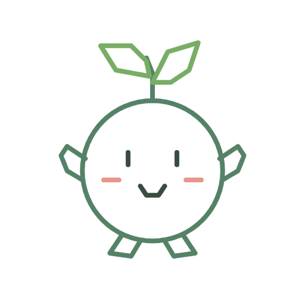
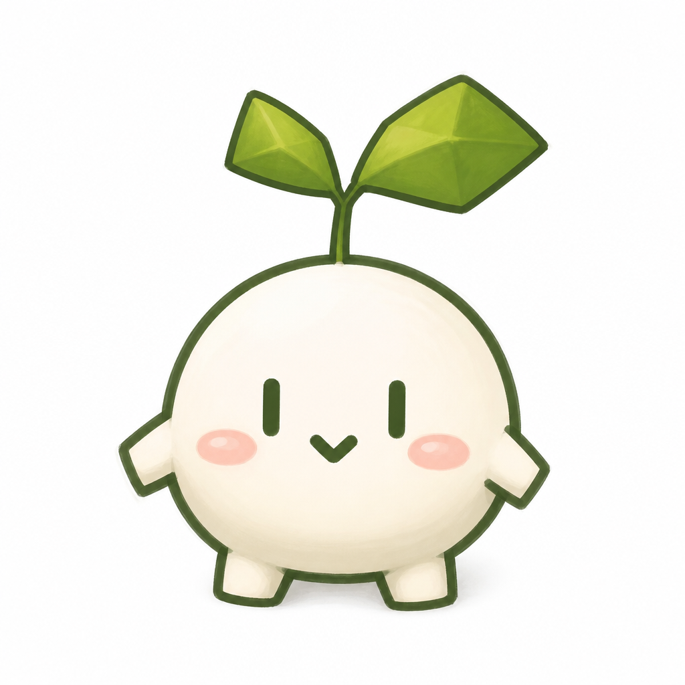
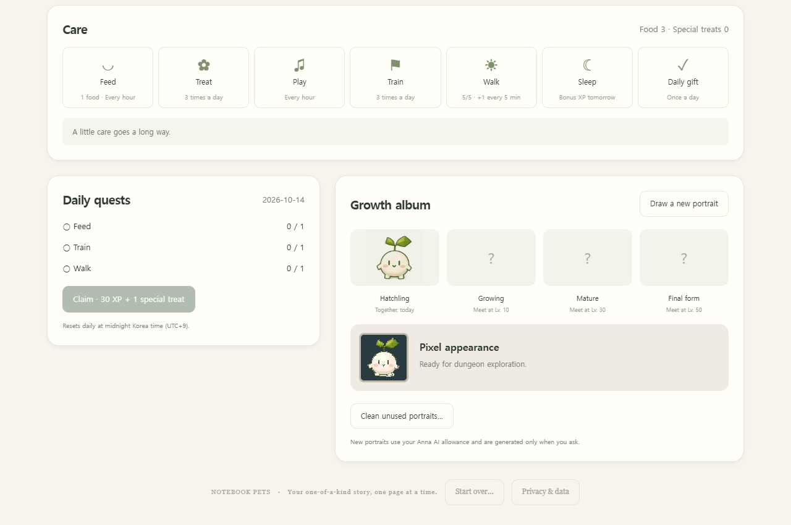
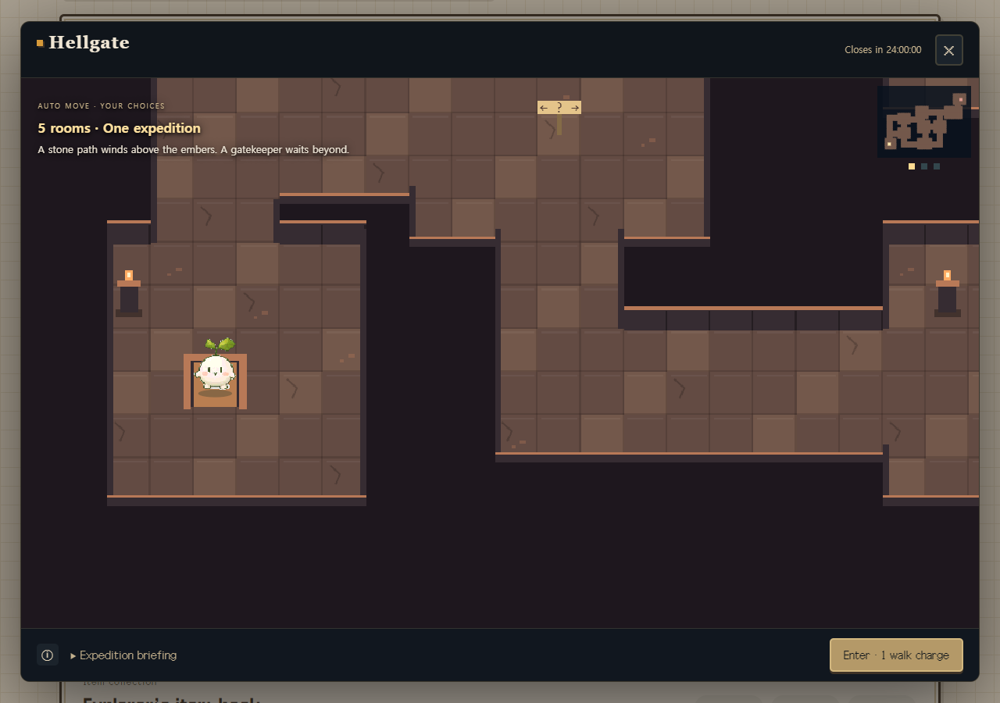
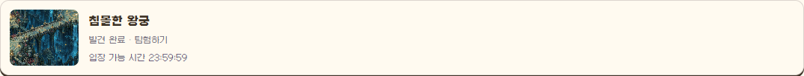
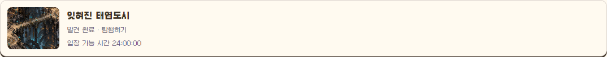
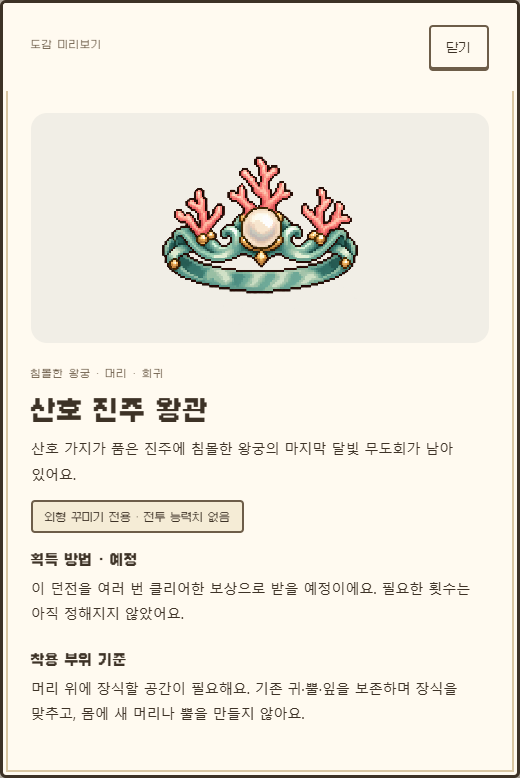
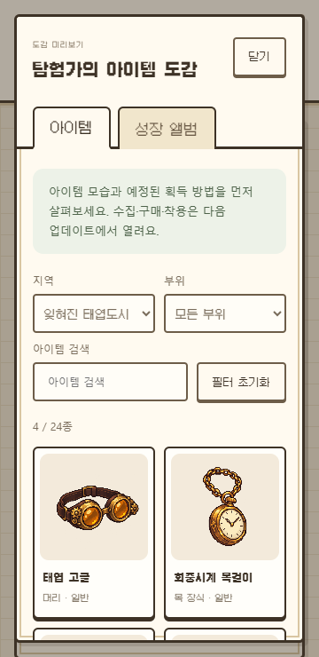

# Notebook Pets · 노트버디

**한국어** · [English](README.en.md)

[문서 목차](docs/README.md) · [현재 설치·배포 상태](anna/HANDOFF.md)

**내가 그린 작은 친구와 대화하고, 돌보고, 함께 모험하세요.**

노트버디는 한 마리의 AI 친구와 일상을 쌓아 가는 육성 게임입니다. 직접 그린 그림이나 사진으로 친구를 만들고, 밥을 주고 이야기를 나누며 성장시킬 수 있어요. 산책길에서는 이어지는 이야기와 픽셀 던전을 만나고, 돌아와서는 성장 앨범과 아이템 도감을 펼쳐 보세요.

현재 Anna 테스트 앱은 **1.4.0**입니다. 노트풍 화면과 입체감 있는 픽셀 친구에 더해, **다섯 던전**과 새 지역의 배경·보스 그림을 만날 수 있어요. 스토어에는 **1.0.0 심사를 요청한 상태**이며, 아직 공개 출시 전입니다. 아래 소개는 2026년 10월 16일 기준입니다.

  

*직접 그린 새싹 그림을 Anna가 분석하고 생성한 친구, Mori예요. 아래 그림과 같은 친구입니다.*

[친구 만들기](#그림-한-장에서-시작하는-우리-친구) · [돌보기와 대화](#밥도-주고-오늘-있었던-일도-들려주세요) · [성장 앨범](#함께-자란-모습을-앨범에) · [산책과 던전](#산책길에서-이야기를-고르세요) · [아이템 도감](#24종의-작은-보물을-먼저-만나보세요) · [사용 안내](anna/README.md)

## 그림 한 장에서 시작하는 우리 친구

마우스나 터치로 간단한 그림을 그려도 좋고, 이미 가지고 있는 그림·사진을 올려도 좋아요. 친구의 이름을 정하고 만나기를 누르면 AI가 몸의 형태와 색, 특징을 살펴보고 새 캐릭터를 그려 줍니다.

| 내가 그린 그림 | 이 그림에서 태어난 Mori |
| :---: | :---: |
|  |  |

- **직접 그리기:** 색을 바꾸고, 지우개와 되돌리기를 쓰며 친구를 그려요.
- **그림·사진 불러오기:** PNG·JPEG·WebP 이미지를 참고 자료로 사용할 수 있어요.
- **랜덤으로 만나기:** 그림을 준비하지 않아도 9종족·8속성의 조합 중 한 친구와 시작할 수 있어요.

그림의 해석이 애매하면 생성 전에 확인하고, 생성에 실패하면 같은 친구로 다시 시도할 수 있어요. 참고 이미지를 바탕으로 AI가 새로 그리는 만큼 결과의 모습에는 차이가 생길 수 있습니다.

실제 그림판 화면 보기

  

## 밥도 주고, 오늘 있었던 일도 들려주세요

먹이와 간식을 챙겨 주고, 놀아 주고, 훈련하고, 잠을 재워 주세요. 포만감과 친밀도를 살피며 하루 한 번 출석 선물과 일일 퀘스트 보상도 받을 수 있어요.

대화창에는 오늘 있었던 일이나 친구에게 하고 싶은 말을 적어 보세요. 친구의 성격과 최근 대화, 함께한 경험을 참고해 답하며, 돌봄 뒤에도 짧게 반응합니다.

**성격도 함께 쌓여요.** 이름과 외형에서 시작한 말투·습관에 돌봄, 훈련, 산책, 모험의 경험이 더해집니다. 호기심·친화성·활동성·신중함의 변화는 성격 화면에서 살펴볼 수 있고, 대화와 산책 이야기에 반영돼요. 채팅 문장만으로 성격 수치가 바로 바뀌는 방식은 아닙니다.

## 함께 자란 모습을 앨범에

작은 유년기에서 시작해 **레벨 10·30·50**에 성장 단계를 맞이합니다. 성장한 모습을 새로 그려 앨범에 남기고, 이전 단계의 모습과 나란히 살펴보세요. 새로운 성장 그림은 원할 때 생성 버튼을 눌러 만들 수 있어요.

  

완성된 초상화로 **픽셀 버전도 함께 준비**합니다. 던전에서도 내가 만든 친구의 외형으로 탐험할 수 있고, 픽셀 변환 자체에는 추가 AI 요청이 없어요.

## 산책길에서 이야기를 고르세요

산책은 경험치를 찾거나 다른 몬스터를 만나는 작은 외출이에요. 이야기를 만나면 두 선택지 중 하나를 고르고, 그 선택의 결과를 확인할 수 있습니다.

현재는 **6종류의 3장 연속 이야기**가 있어요. 앞선 선택과 돌봄·모험의 경험이 다음 사건과 준비 조건, 결말에 영향을 줍니다. 도중에 닫아도 **산책 이어가기**로 돌아올 수 있어요.

산책 횟수는 현재 **5분마다 1개씩, 최대 5개**까지 회복됩니다.

## 산책 중 발견하는 다섯 가지 픽셀 던전

산책하다 보면 확률로 던전을 발견합니다. 발견한 던전은 **24시간** 동안 열려 있고, 남은 시간이 화면에 표시돼요. 하나를 발견했다면 클리어하거나 문이 닫힐 때까지 다른 던전은 나오지 않습니다.

| 던전 | 탐험 분위기 |
| --- | --- |
| **지옥문** | 잿불과 용암, 봉인된 문을 향한 모험 |
| **얼음왕국** | 눈과 얼음에 둘러싸인 차가운 왕국 |
| **몽환의 숲** | 신비로운 빛과 꿈이 깃든 숲 |
| **침몰한 왕궁** | 산호와 푸른 심해에 잠긴 궁전, 심해의 왕관지기 |
| **잊혀진 태엽도시** | 낡은 황동 톱니와 시계 장치, 거대 태엽 골렘 |

  

*지옥문 입장 전 미리보기예요. 메인 화면의 Mori가 같은 외형의 픽셀 친구로 나타납니다.*

친구가 자동으로 이동하고 카메라가 따라갑니다. **3~6개 방**을 탐험하며 갈림길·함정에서 선택하고, 긴 탐험에서는 회복의 기회를 거쳐 마지막 수호자에게 도전해요. 종족별 지역 적응과 속성 상성도 입장 전에 확인할 수 있습니다.

각 스테이지에 들어갈 때 산책 횟수 1개를 사용하고, 지역별 하루 첫 클리어에는 10코인을 받아요. 다음 스테이지는 직접 입장을 선택하며, 이동 연출은 일시정지·3배속·건너뛰기를 지원합니다.

| 침몰한 왕궁의 발견 카드 | 잊혀진 태엽도시의 발견 카드 |
| :---: | :---: |
|  |  |

*1.1.1의 실제 화면을 테스트 데이터로 촬영했어요. 각 카드는 서로 다른 발견 예시입니다. 탐험은 기존 방·복도 맵에서 진행하고, 마지막 방에서 각 지역의 전용 보스를 만나요.*

## 24종의 작은 보물을 먼저 만나보세요

**1.1.2에서 도감이 24종으로 늘었어요.** 홈의 **아이템 둘러보기**를 누르면 공용·지옥문·얼음왕국·몽환의 숲·침몰한 왕궁·잊혀진 태엽도시 아이템을 각 4개씩 볼 수 있습니다. 친구를 만난 뒤 홈에서 열 수 있어요.

  

지역·부위별로 걸러 보거나 이름을 검색해 보세요. 아이템을 누르면 그림과 이야기, 희귀도, **획득 방법**과 착용에 필요한 부위를 자세히 볼 수 있어요. 작은 여행자 모자부터 서리 왕관, 나비 망토, 산호 진주 왕관, 태엽 고글까지 준비했습니다.

| 아이템 상세 | 작은 화면에서도 |
| :---: | :---: |
|  |  |

**1.2.0부터 던전 아이템을 모을 수 있어요.** 마지막 수호자를 클리어하면 그 지역의 미보유 일반 아이템을 하나 받고, 일반 3종 다음 클리어에는 희귀 아이템을 받아요. **내 보관함**에서 보유 현황을 확인하세요. 중복 지급과 과거 클리어 소급 지급은 없으며 지역별 4종을 모은 뒤에는 기존 코인만 받아요. 공용 4종·상점·착용은 아직 제공하지 않습니다. 보관함·도감 조회와 보상 지급에는 AI를 사용하지 않아요.

앞으로 착용 기능에서는 캐릭터의 몸 형태를 먼저 확인할 예정이에요. 손이 없는 친구도 장갑을 수집할 수 있지만, 장갑을 끼우려고 없던 손을 만들지는 않아요. 주변을 맴도는 별빛 같은 장식은 팔다리가 없어도 사용할 수 있도록 계획하고 있습니다.

## 어디서 사용할 수 있나요?

| 방식 | 현재 상태 |
| --- | --- |
| **Anna 앱** | 위 화면과 기능을 제공하는 소유자 테스트 버전 **1.4.0**. 스토어 공개는 **1.0.0 심사 대기** 중이에요. [앱 사용 안내](anna/README.md) |
| **오픈소스 엔진·Discord·AI 에이전트** | 직접 실행하거나 연결할 수 있어요. Anna 전용 화면·산책 이야기·도감과는 제공 범위가 달라요. [설치와 연결 안내](docs/DEVELOPMENT.md) |

Anna 화면은 **한국어와 영어**를 지원합니다. 상단에서 언어를 선택하면 새 답변도 그 언어로 받을 수 있어요. 친구와 최근 대화·성장 기록은 사용자별로 저장됩니다.

대화, 돌봄 반응, 성격·산책 이야기 생성, 그림·사진 분석과 새 초상화 생성에는 **사용하는 Anna 계정의 AI 사용량**이 적용됩니다. 랜덤 친구도 초기 성격을 만들 때 AI를 사용해요. 이미지 파일 선택·미리보기, 아이템 도감 조회, 픽셀 변환 자체는 AI를 호출하지 않습니다.

## 앞으로 함께 만들 것들

지역 아이템 수집과 보관함 다음으로 **코인 상점·착용**을 만들 예정입니다. 캐릭터 부위 분석과 원본을 유지하는 착용 그림 생성은 이미지 편집 API 지원과 품질 확인 후 연결해요.

**침몰한 왕궁·잊혀진 태엽도시는 지금 탐험할 수 있어요.** 이후 공중성·도서관·사막 테마를 계획하고 있습니다. 착용과 후속 지역은 아직 제공하지 않아요. [아이템 계획](anna/docs/ITEMS.md)

---

[Anna 사용 안내](anna/README.md) · [엔진·Discord 개발 안내](docs/DEVELOPMENT.md) · [Anna 개발 안내](anna/DEVELOPMENT.md) · [최신 배포 기록](anna/releases/RELEASE_112.md) · [개인정보 안내](anna/PRIVACY.md)

스크린샷은 실제 앱 UI를 별도 테스트 데이터로 실행해 촬영했습니다. 친구 생성·앨범·지옥문은 1.0.0 화면, 새 던전 두 곳은 1.1.1 화면, 도감과 상세는 1.1.2 화면이며, 위 Mori의 그림은 실제 Anna 생성 결과입니다. [화면 출처](docs/screenshots/README.md)

