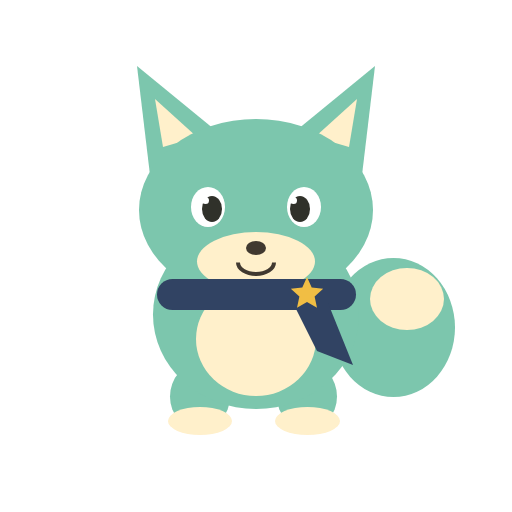
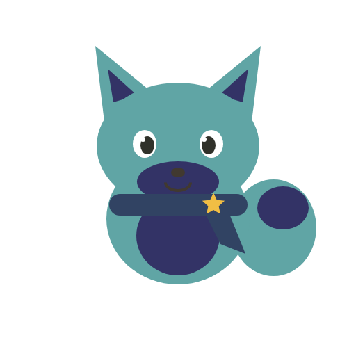

# Android 검증 기록

## 0.2.0-alpha · 게임 통합 · 2026-10-23

PC에서 게임 통합과 APK 빌드를 검증했습니다. **이 버전의 플립6 설치 및 실제 WebView + 로컬 AI 통합 검증은 USB 재연결 대기 상태입니다.** 아래의 0.1.0 측정 수치는 새 게임판의 성능 측정값이 아닙니다.

- APK / 테스트 APK 빌드 성공. 단위 테스트 20개 통과. Lint 오류 0개, 권고 18개.
- Android 패키징 결과를 Edge 모바일 브라우저에서 실행하고 실제 Pyodide/Python 게임 엔진을 사용했습니다. 네이티브 AI 응답만 모의 처리했습니다.
- 직접 그리기·사진 선택·그림 없는 생성 거절·그림과 게임의 동시 저장·먹이·최근 대화 전달/복구 통과.
- 홈 기본 픽셀 선택, 가구 구매/명시적 AI 배치, 산책 결말 완료, 던전 입장/탐험 통과.
- 조건을 만족한 테스트 친구의 진화: 잘못된 AI JSON에도 기본 세 방향을 선택할 수 있으며, 단계가 바뀌어도 원본 그림을 유지함을 확인.
- 백업 직렬화/분할 전달 및 재실행 후 게임 복구 통과. Android 파일 저장 다이얼로그와 물리 기기의 사진 선택은 아직 실기기 확인 전.
- 너비 320/360/412/800px에서 가로 넘침 없음. 테스트 중 외부 HTTP 요청 0회.
- 공통 Python/WASM 스모크 검증 통과: 보상·재시도 멱등성·파일시스템 어댑터 미로딩 확인.
- `GameSmokeTest`는 `notebuddy-android-test` 공책만 변경하고 사용자 게임 저장 스냅샷 및 Lab 원본/분석/대화 파일 해시를 전후 비교하도록 준비했습니다. 아직 이번 버전에서 실행하지 않았습니다.

남은 실기기 확인: 기존 앱 위 업데이트, 모델 재사용, 실제 로컬 대화/사진 입력, 키보드·시스템 뒤로 가기·회전·프로세스 재시작, SAF 백업 내보내기/가져오기, 물리 오프라인 실행, 장시간 발열·메모리. 새 이미지 생성과 iOS, Play Store 제출은 이번 범위에 포함하지 않습니다.

---

# Android AI Lab · 실기기 검증

2026-10-23, `0.1.0-lab`. **대화 연결 가능성을 확인한 검증판이며, 노트버디 전체 모바일 출시본이 아닙니다.**

## 결론

- Galaxy Z Flip6에서 유료 API 호출 없이 한국어 대화, 최근 대화의 이름 기억, 이미지 입력과 구조화된 응답을 실행했습니다.
- 짧은 후속 대화는 빠르지만, 그림의 세부 특징을 놓쳤습니다. 현재 특징 조합 일러스트는 기존 노트버디의 이미지 생성 품질을 대체할 수 없습니다.
- 따라서 대화 어댑터는 후속 게임 통합 후보입니다. 캐릭터 이미지 생성은 별도 기술 검증이 필요합니다. 전체 기능 동등성을 전제로 모바일 출시를 진행하면 안 됩니다.

## 측정 환경

Samsung Galaxy Z Flip6(SM-F741N), Android API 36, arm64, RAM 약 12 GB. Gemma 4 E2B의 텍스트 GPU / 비전 CPU 백엔드를 사용했습니다. 모델은 사용자가 앱에서 다운로드하고 해시 검증을 마친 파일을 재사용했습니다.

USB 충전 중이며, 짧은 단일 기기 검증입니다. 아래 값은 보장 성능이나 장시간 벤치마크가 아닙니다. CPU 전용 모드, 다른 휴대폰, 실제 비행기 모드, 접힌 커버 화면은 아직 검증하지 않았습니다. AI 호출은 LiteRT-LM 로컬 엔진으로만 전달하며, 실제 네트워크 차단 상태를 측정한 것은 아닙니다.

| 요청 | 모델 준비 | 첫 응답 | 전체 답변 |
|---|---:|---:|---:|
| 첫 한국어 대화 | 4.891초 | 0.774초 | 1.405초 |
| 그림 → 특징 JSON | 0초 | 6.927초 | 14.266초 |
| 이름 기억 확인 | 0초 | 0.217초 | 0.474초 |
| 짧은 후속 대화 1 | 0초 | 0.183초 | 0.443초 |
| 짧은 후속 대화 2 | 0초 | 0.141초 | 0.380초 |

첫 응답과 전체 답변 시간은 모델 준비 이후부터 측정했습니다. 그림 결과 시간에는 JSON 출력이 포함됩니다. 엔진 준비 시 디스크 캐시가 이미 존재할 수 있으므로 최초 설치 직후의 GPU 컴파일 시간과 같다고 단정하지 않습니다.

프로세스 PSS는 대화 후 약 2.11 GiB, 그림 분석 후 약 3.09 GiB, 마지막 두 대화 후 약 3.03 GiB였습니다. 5회 요청 범위에서 계속 증가하는 패턴은 관찰되지 않았지만 장시간 누수 여부까지 검증한 것은 아닙니다. 배터리 온도는 37.9°C → 38.6°C였습니다. 충전 중 측정이므로 배터리 사용 시간은 추정하지 않습니다.

## 그림 품질

다음 이미지는 테스트 코드로 만든 샘플이며 사용자 사진이 아닙니다.

| 입력 샘플 | 분석한 특징으로 다시 그린 결과 |
|---|---|
|  |  |

청록 계열 색상, 뾰족한 귀, 꼬리와 목도리는 인식했습니다. 그러나 발을 놓쳐 `limbs=0`을 반환했고, 배 색상도 원본과 달랐습니다. 성격 문장에는 어색한 표현이 있었습니다. 별도의 실제 사진 UI 테스트에서도 흰 강아지라는 큰 특징은 인식했지만 다리와 꼬리가 누락됐습니다. 개인 사진과 그 분석 파일은 저장소에 포함하지 않습니다.

이는 `이미지 입력 처리 성공`과 `캐릭터 재현 품질 통과`가 다르다는 근거입니다. **이미지 품질 검증은 미통과**로 기록합니다.

## 자동 검증

- APK 및 테스트 APK 빌드 성공.
- JVM 테스트 15개 통과: 다운로드/이어받기, Range 무시·불일치, 손상 파일 거부, 해시 검증, 중단 후 재개, 모델 삭제 시 그림 보존, 특징 JSON 검증.
- 기기 테스트 3개 통과: 한국어 대화·비전·반복 대화, 투명 배경 일러스트 렌더링, Activity 재생성 후 미전송 문장·백엔드 선택 유지.
- 최종 실기기 AI 테스트는 실행 전후 사용자 입력 그림·캐릭터·대화 파일의 해시가 동일한지 확인합니다.
- Android Lint: 오류 0개, 권고 경고 14개. 주로 의존성 업데이트, KTX 사용 제안, 문자열 구성 및 여유 공간 API 권고입니다.
- 실제 앱의 분석 버튼을 눌러 로컬 모델 호출 및 캐릭터 저장을 확인했습니다.

## 테스트 도중 수정한 문제

초기 실기기 테스트가 앱의 실제 저장 파일을 테스트 샘플과 공유하여, 사용 중인 검증판의 캐릭터와 대화를 샘플로 교체했습니다. 입력 사진은 남아 있어 실제 UI에서 재분석했습니다. 최초 입력/대화를 모두 복구했다고 주장하지 않습니다.

테스트 이미지를 앱 캐시의 별도 파일로 옮기고, 테스트의 캐릭터·대화 저장 쓰기를 제거했습니다. 마지막 테스트에서는 사용자 파일 해시가 바뀌지 않았습니다. 이후 검증 시에도 테스트 중 사용자의 동시 입력과 결과를 혼동하지 않도록 구분합니다.

## 남은 일

1. 원본을 충분히 살리는 캐릭터 이미지 경로 선정 및 품질 비교. 현재 조합 그림으로 기존 기능을 대체하지 않기.
2. 장시간 대화·화면 전환·취소·메모리 압박과 CPU 전용 모드 검증.
3. Android 생명주기 및 로컬 AI 어댑터를 기존 공유 게임 UI/`engine/game_api.py`에 연결. 게임 규칙 복제 금지.
4. 게임 저장·복구, 휴대폰별 레이아웃, 서명·업데이트·스토어 배포 준비. iOS는 별도 검증 필요.
