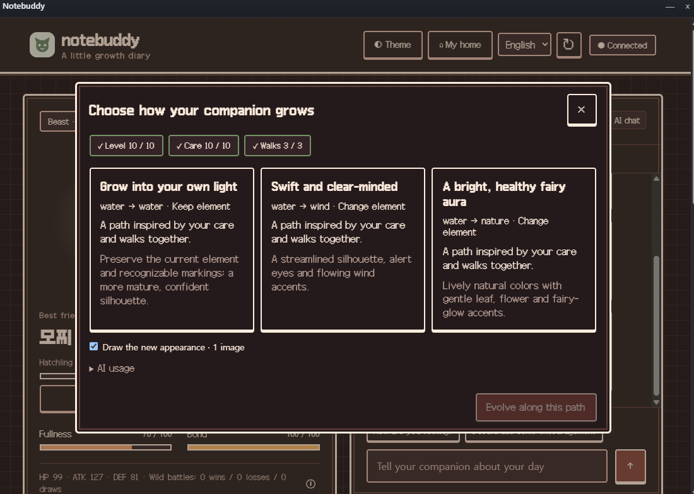

# Notebuddy · Your little companion on Anna

[한국어](README.md) · **English** · [Full feature gallery](../README.en.md)

Meet a friend from your own drawing, offer them a meal, tell them about your day and take a walk together. Notebuddy is a game about **growing alongside one companion through everyday care and little adventures**.

**[Get Notebuddy on the Anna App Store](https://anna.partners/store/@kdkrkwhr/notebuddy)**

Anna is a platform for installing and using AI apps. An Anna account is required; chat, image generation and other AI features use your own account's AI allowance.

  

## What is available today?

**1.4.13 has passed review and is now publicly available on the Anna App Store.** It uses game tool **0.9.5** and includes personalized evolution choices, home and garden decoration, five pixel dungeons and regional item collection. Equipment is planned for a later update. See the [current deployment status](HANDOFF.md).

Since 1.2.0, each final guardian clear grants one unowned regional item: three standard rewards, then the rare reward. Open **My inventory** to see owned items. There are no duplicate or retroactive grants; after all four regional items, clears retain their coin rewards. Common collectible items and equipment are deferred. The home furniture shop is available in 1.4.0. Collection and browsing make no AI requests.

## Clear progress while you wait

Image creation, home pixel generation, evolution and chat show the current step and elapsed time. After 30 seconds, continued-wait guidance explains that another request is unnecessary. Received images switch to saving; failed saves keep their save-only recovery. Waiting feedback clears on completion or failure, and mobile home controls make room for it. The clock is elapsed time, not a predicted finish time.

This screenshot uses an isolated controlled delay in the actual UI; no paid AI request or owner save was used.

## Choose your evolution

From 1.4.11, leveling alone never evolves your companion. Meet lifetime activity requirements, then select **Evolve below the XP bar → Explore three paths**. Growing requires Lv.10, 10 care actions and 3 walks; Mature requires Lv.30, 30 care actions, 10 training and 15 walks; Final form requires Lv.50, 60 care actions, 25 training, 30 walks and 3 completed story arcs. Care includes feeding, treats, play and sleep. Finish pending walk or dungeon choices before evolving.

AI considers care, adventures, recent direct conversations and memories of previous evolutions. Compare **three paths**, including one that keeps the current element and two alternatives, select a card and choose **Evolve along this path**.

Suggestions and appearance observations use one AI request; the chosen new portrait uses one image request. Evolution uses observed features in a text-to-image prompt, without image editing. Uncheck **Draw the new appearance** to keep the existing portrait. Failed suggestions fall back to activity-based choices; an image failure preserves evolution and previous artwork. Save recovery does not repeat AI requests. Choose the new portrait's home pixel appearance separately on the first visit.

## Your first meeting

Choose **◐ Theme** in the header to change your notebook's mood. Seven themes include Notebook, Quiet Night and all five dungeon settings. Changes preview immediately and stay on this device. Artwork and game-world colors remain intact; choosing themes uses no AI. The public web version offers the same themes.

1. Visit the [Notebuddy store page](https://anna.partners/store/@kdkrkwhr/notebuddy), sign in with your Anna account and open **Notebuddy**. English is the default; choose **한국어** in the header for Korean.
2. Name your companion and choose **Surprise me** or **From a drawing or photo**.
3. For a reference-based friend, draw or select an image, then choose Meet. AI analyzes its features and creates a portrait.
4. Offer your new friend some food and say hello. Open the personality panel to learn about their voice and habits.

  

**The sprout in this editor became the Mori shown above.** Drawing supports colors, an eraser and undo; uploads support PNG, JPEG and WebP. Selecting or previewing an image does not call AI. Uncertain interpretations ask for confirmation, and generated appearances can differ from the reference.

## What would you like to do today?

| Activity | What you can do |
| --- | --- |
| **Care for your friend** | Feed, treat, play, train and rest. Watch fullness and bond, collect a daily gift, and claim daily quest rewards. |
| **Have a conversation** | Replies use personality, recent conversation and shared experience. Care also receives a short reaction. |
| **Get to know their personality** | Inspect curiosity, warmth, energy and caution as actual care and adventure experiences accumulate and inform replies and stories. |
| **Keep a growth album** | Meet level and activity requirements, choose an evolution path and view saved artwork. |
| **Take a walk** | Find XP, meet creatures or choose a story outcome. Six three-chapter arcs carry earlier choices and experiences forward. |
| **Explore a dungeon** | Discover Hellgate, Ice Kingdom, Dream Forest, Sunken Palace or Forgotten Clockwork City during walks, then enjoy automatic movement, room choices and battles. |
| **Browse little treasures** | Open **Browse items** for twenty-four illustrations with lore, rarity, planned rewards and fit requirements. |

Walk charges recover **one every five minutes, up to five**. Each discovered dungeon lasts **24 hours**, and another will not appear until it is cleared or expires. Each stage costs one charge; the first clear of each region per day awards 10 coins. Daily rules reset at midnight Korea time.

## A twenty-four-item book

Everyday adventures and the five dungeon collections each offer one head, neck, back and surrounding-effect design. Filter by region or type, search for a name, and open an item to take a closer look.

  

In 1.2.0, each final guardian clear grants one unowned regional item: three standard rewards, then the rare reward. Open **My inventory** to see owned items. There are no duplicate or retroactive grants; after all four regional items, clears retain their coin rewards. Common collectible items and equipment are deferred. The home furniture shop is available in 1.4.0. Collection and browsing make no AI requests.

## Return to your friend

Growth, recent conversation and artwork are stored separately for each user. Resume a pending story with **Continue walk**. Reopening the app does not require creating your companion again.

Chat, optional care replies and walk narration, initial personality, reference analysis, portrait generation, optional home pixel generation and requested decoration use **your Anna AI allowance**. Care AI can be disabled above chat without losing actions, stats or rewards; direct chat still uses AI. Random portraits are bundled but their initial personality uses AI. Purchases, visits, movement and free pixel conversion do not call AI.

Switching between English and Korean changes the interface and new replies while keeping names and previous conversations intact. To create a different companion, use **Start over** and confirm what will be deleted. Deleted companions and records cannot be recovered. [Privacy and data guide](PRIVACY.md)

---

[Full feature gallery](../README.en.md) · [Development and setup](DEVELOPMENT.en.md) · [Technical documents](docs/README.md) · [Deployment history](releases/README.md) · [Review history](reviews/README.md) · [Handoff](HANDOFF.md)

The evolution screenshot is an owner-provided capture of actual 1.4.11 testing. Other images use isolated demo data; Mori is an actual Anna-generated result. [Screenshot sources](../docs/screenshots/README.md)

## My home

Open **My home**, buy objects with game coins, then choose **Decorate**. Browse **12 indoor and 36 garden objects**, with area and garden-style filters. Flowers, trees, outdoor lounges, water features, storybook accents and natural gardens offer six different tastes. Your companion chooses a validated layout; each request places at most three stored objects. Indoor furniture has a carrying animation; garden objects appear in their finished positions. Undo restores both areas while keeping your purchases.

Decorate makes one bounded layout-selection request. Purchases, room visits, movement, idle life, undo and save-only retries use no AI. Room geometry, furniture and the companion are rendered separately.

In **1.4.3**, the home becomes a large pixel garden and separate indoor room. Your friend automatically follows paths through the door, changes poses with direction, and passes behind objects. Follow the camera, zoom in or pause to watch. Furniture opens in a separate panel.

On the first home visit for an appearance, choose one AI image request for directional pixel poses or a free default pixel image converted from the existing portrait. Saving a companion does not automatically request movement images. Home and dungeons share the saved result. Manual portrait redraw has been removed.

A failed pose request leaves the companion and portrait intact and sets a free default without automatic AI retries. If only saving failed, use **Retry saving movement** in My home; this uses no AI. Reopening and moving reuse the saved appearance.
