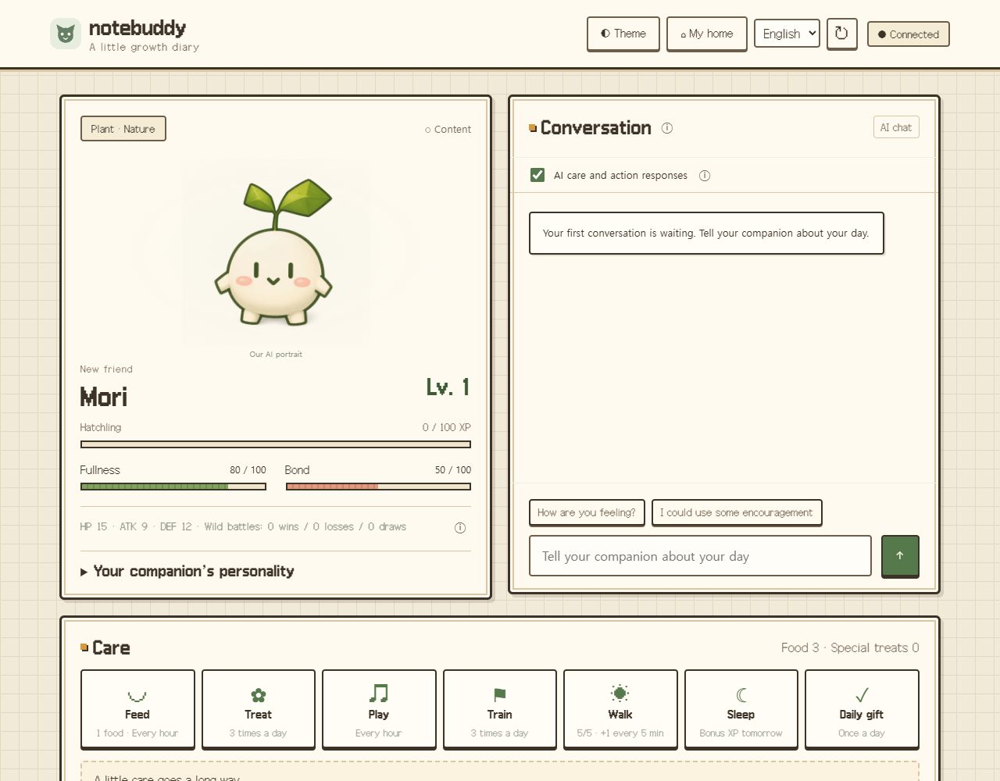
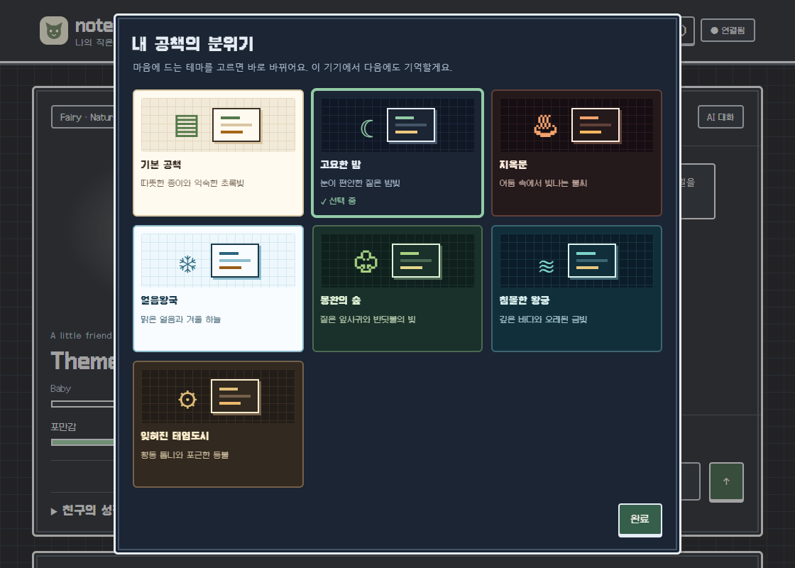
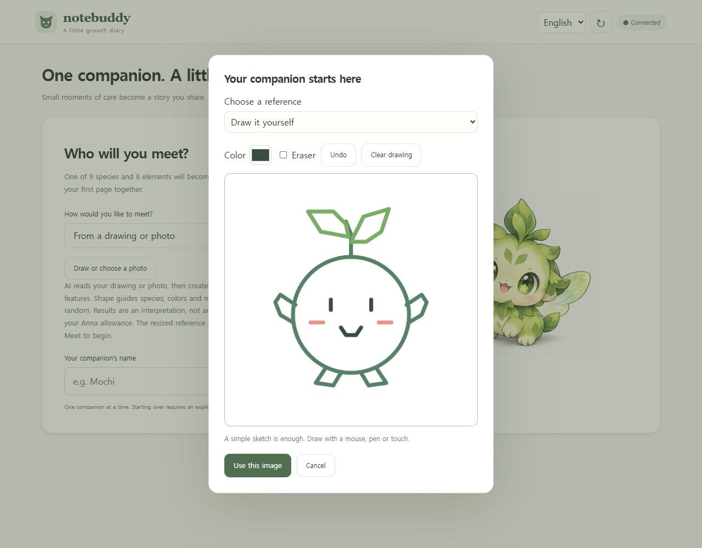
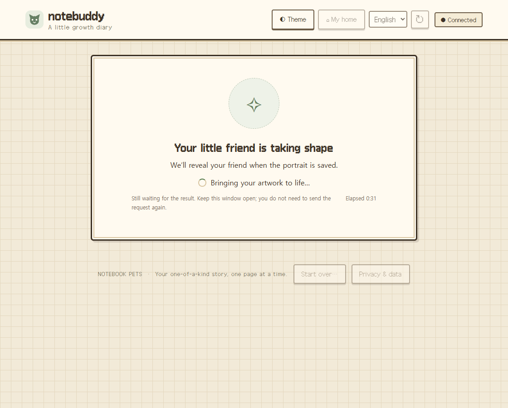
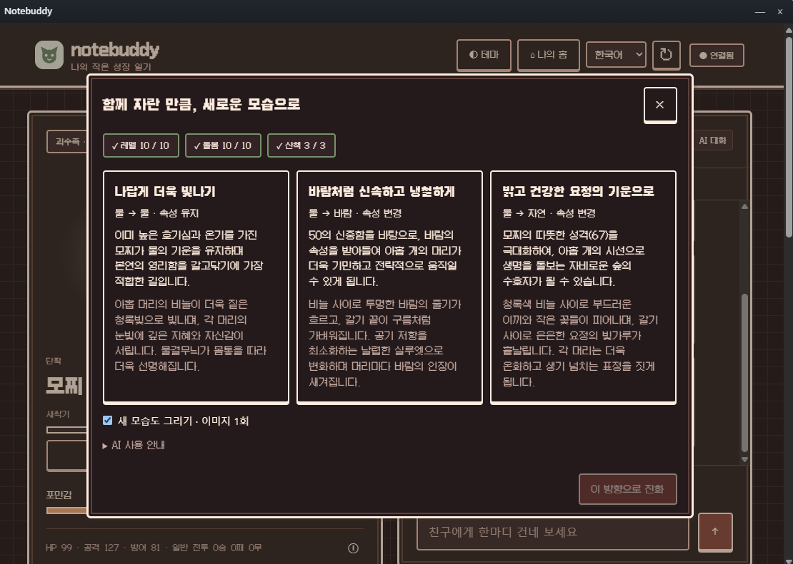
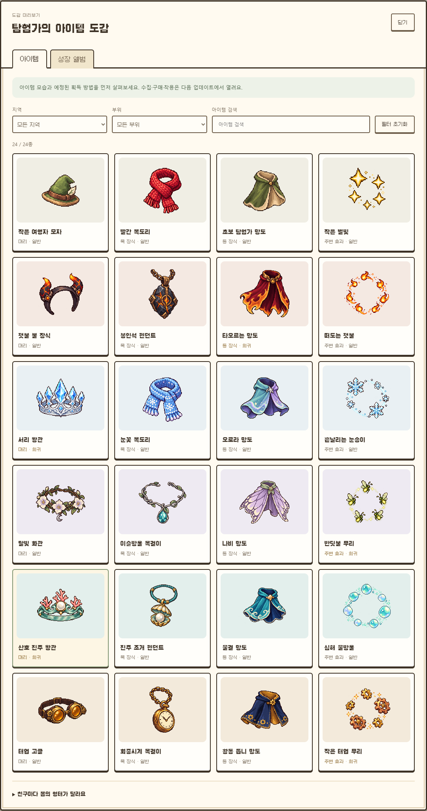
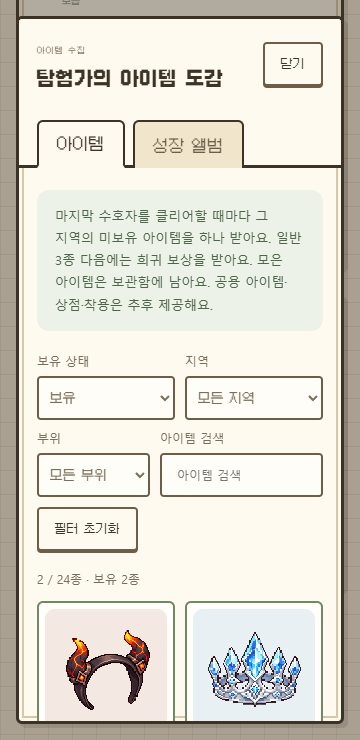

# Notebuddy · Anna에서 만나는 나만의 친구

**한국어** · [English](README.en.md) · [전체 기능과 스크린샷](../README.md)

그림 한 장에서 태어난 친구에게 밥을 주고, 오늘 있었던 일을 들려주고, 함께 산책해 보세요. 노트버디는 **한 마리의 친구와 성장과 모험을 쌓아 가는 게임**입니다.

**[Anna 스토어에서 노트버디 다운로드](https://anna.partners/store/@kdkrkwhr/notebuddy)**

**1.4.14 업데이트는 심사 중입니다.** 소유자 테스트 앱에서 영어·한국어·일본어·중국어 간체·번체를 선택할 수 있습니다. 기존 대화와 생성된 이야기는 원문을 유지하며 언어 변경에 AI를 쓰지 않습니다. 현재 스토어 공개 버전은 1.4.13입니다.

Anna는 여러 AI 앱을 설치해 사용하는 플랫폼이에요. Anna 계정으로 시작할 수 있으며, 대화·이미지 생성 등에는 본인 계정의 AI 사용량이 적용됩니다.

  

## 현재 어디까지 사용할 수 있나요?

**1.4.13이 심사를 통과해 Anna 스토어에 공개됐어요.** 게임 도구는 **0.9.5**를 사용합니다. 조건을 채운 뒤 세 가지 방향 중 하나를 고르는 수동 진화, 집과 마당 꾸미기, 다섯 픽셀 던전과 지역 아이템 수집을 제공합니다. 도감 아이템 착용은 후속 업데이트입니다. [현재 배포 상태](HANDOFF.md)

## 처음 만나는 순서

긴 보조 설명은 **ⓘ**에 마우스를 올리거나 눌러서 확인할 수 있어요. 키보드 초점으로도 열리고 Esc나 바깥 클릭으로 닫혀요. 오류·진행 상태와 행동 비용은 계속 표시해요.

상단 **◐ 테마**에서 공책의 분위기를 바꿀 수 있어요. 기본 공책·고요한 밤과 다섯 던전(지옥문·얼음왕국·몽환의 숲·침몰한 왕궁·잊혀진 태엽도시)까지 **7가지 테마**를 제공합니다. 고르면 바로 적용되고 이 기기에서 기억해요. 캐릭터 그림과 게임 공간의 색은 그대로이며 AI 사용량은 들지 않아요. 공개 웹에서도 같은 테마를 선택할 수 있어요.

1. [노트버디 스토어 페이지](https://anna.partners/store/@kdkrkwhr/notebuddy)에서 Anna 계정으로 로그인한 뒤 **Notebuddy**를 열어요. 첫 화면은 영어이며, 상단에서 **한국어**로 바꿀 수 있어요.
2. 이름을 정하고 **랜덤으로 만나기** 또는 **그림·사진으로 만나기**를 선택해요.
3. 그림·사진을 선택했다면 직접 그리거나 파일을 고른 뒤 만나기를 눌러요. AI가 특징을 분석하고 친구의 모습을 그립니다.
4. 완성된 친구에게 먹이를 주고, 말을 걸어 보세요. 성격 패널에서 친구의 말투와 특징도 살펴볼 수 있어요.

  

**위 그림판의 새싹이 첫 화면의 Mori로 태어났어요.** 직접 그리기에는 색상·지우개·되돌리기가 있고, 파일은 PNG·JPEG·WebP를 지원합니다. 파일 선택과 미리보기만으로는 AI를 사용하지 않아요. 해석이 애매하면 생성 전에 확인하며, 생성된 모습은 원본과 차이가 있을 수 있어요.

## 기다리는 동안에도 진행 상태 확인하기

이미지 생성, 마이홈 픽셀 생성, 진화와 채팅에서 현재 단계와 경과 시간을 보여줘요. 30초 이상 기다리면 같은 요청을 다시 보낼 필요가 없다는 안내가 나타나요. 이미지를 받은 뒤에는 저장 단계로 바뀌며, 완료·실패 후에는 진행 표시를 정리하고 필요한 복구 버튼을 보여줘요. 모바일 마이홈에서도 안내가 가려지지 않도록 작업 중인 선택과 버튼을 잠시 숨깁니다. 경과 시간은 예상 완료 시간이나 완료율이 아니에요.

위 화면은 실제 UI에서 응답 지연을 재현해 촬영했습니다. 추가 유료 AI 호출이나 소유자 데이터 변경은 없어요.

## 원하는 방향으로 직접 진화하기

1.4.11부터 레벨만으로 자동 진화하지 않아요. 레벨과 누적 활동 조건을 채운 뒤 **친구 정보의 경험치 바 아래 ‘진화’ → ‘세 가지 진화 방향 보기’**를 눌러 주세요. 성장기(Lv.10·돌봄 10·산책 3), 성숙기(Lv.30·돌봄 30·훈련 10·산책 15), 완전체(Lv.50·돌봄 60·훈련 25·산책 30·이야기 완결 3)로 한 단계씩 진행해요. 돌봄은 먹이·간식·놀이·수면의 합계이며, 진행 중인 산책·탐험 선택은 먼저 마쳐야 합니다.

AI가 **돌봄·모험 기록, 최근 대화와 이전 진화 기억**을 참고해 세 방향을 제안합니다. 현재 속성을 유지하는 길과 다른 속성으로 바뀌는 두 길의 외형·이유를 비교하고, 원하는 카드를 고른 뒤 **이 방향으로 진화**를 눌러요.

방향 제안과 현재 모습의 특징 분석에 AI 1회, 선택한 새 모습에 이미지 1회를 사용해요. 진화 그림은 추출한 특징과 선택한 외형을 텍스트로 전달해 생성하며 image-to-image를 사용하지 않습니다. **새 모습도 그리기**를 끄면 기존 그림으로 진화해요. 제안 실패 시 활동 기록에 맞춘 기본 선택지를 제공하고, 그림 생성 실패 시 진화 기록과 이전 초상화를 보존합니다. 저장 재시도는 새 AI 요청을 보내지 않아요. 새 초상화의 마이홈 픽셀 모습은 첫 방문 때 따로 선택해요.

## 오늘의 활동

| 하고 싶은 일 | 이렇게 즐겨요 |
| --- | --- |
| **친구 돌보기** | 먹이·간식·놀이·훈련·수면으로 포만감과 친밀도를 챙겨요. 하루 한 번 출석 선물과 일일 퀘스트 보상도 있어요. |
| **대화하기** | 친구의 성격, 최근 대화와 함께한 경험을 바탕으로 답해요. 돌봄 뒤에는 짧은 반응도 들을 수 있어요. |
| **성격 알아가기** | 호기심·친화성·활동성·신중함을 살펴봐요. 실제 돌봄과 모험의 경험이 누적되며 대화·이야기에 반영돼요. |
| **성장 기록하기** | 레벨·활동 조건을 채우고 진화 방향을 직접 고른 뒤, 저장된 그림을 앨범에서 봐요. |
| **산책하기** | 경험치 발견·몬스터 조우·선택형 이야기를 만나요. 6종의 3장 연속 이야기는 앞선 선택과 경험을 이어 받아요. |
| **던전 탐험하기** | 산책 중 발견한 지옥문·얼음왕국·몽환의 숲·침몰한 왕궁·잊혀진 태엽도시에서 자동 이동과 방별 선택, 전투를 즐겨요. |
| **아이템 구경하기** | 홈의 **아이템 둘러보기**에서 24종 그림과 설명·희귀도·획득 예정 방법·착용 조건을 확인해요. |

새 던전은 산책의 선택·전투 결과에서 발견 소식을 확인하고 돌아온 뒤 홈 목록에 나타나요. 진행 중인 산책을 닫거나 새로고침해도 새 발견을 먼저 공개하지 않아요. 이미 확인한 던전은 계속 표시돼요.

산책 횟수는 **5분마다 1개, 최대 5개**까지 채워져요. 던전은 **발견부터 24시간** 동안 유지되고, 클리어하거나 닫히기 전에는 다른 던전이 나오지 않아요. 스테이지마다 산책 횟수 1개를 사용하며, 지역별 하루 첫 클리어에 10코인을 받습니다. 일일 기준은 한국 시간 자정입니다.

## 24종 아이템 도감

공용·지옥문·얼음왕국·몽환의 숲·침몰한 왕궁·잊혀진 태엽도시마다 머리·목·등·주변 효과 아이템이 하나씩 있어요. 지역과 부위로 걸러 보거나 이름을 검색하고, 마음에 드는 아이템을 눌러 자세히 살펴보세요.

  

마지막 수호자를 클리어하면 지역별 일반 아이템 3종을 하나씩, 그다음에는 희귀 아이템 1종을 받아요. **내 보관함**과 도감의 보유·미보유 필터에서 확인하세요. 중복·소급 지급은 없고 지역별 4종을 모은 뒤에는 기존 코인 보상만 받아요. 공용 4종·구매·착용은 후속 기능입니다. 보관함 조회와 보상 지급은 AI를 호출하지 않습니다. [아이템 안내](docs/ITEMS.md)

## 이어서 즐기기와 AI 사용량

채팅 위 **돌봄·행동 AI 반응**을 끄면 행동·상태·경험치·보상만 처리하고 AI 반응을 요청하지 않아요. 산책 선택지는 AI 없이 기본 이야기로 제공해요. 기본값은 ON이며 설정은 같은 기기의 브라우저에 저장돼요. 직접 보내는 채팅·새 그림·성격 생성·마이홈 생성·꾸며 줘는 별도 기능으로 AI를 사용해요. 이미 전송한 AI 요청은 OFF 이후에도 완료될 수 있어요.

친구의 성장, 최근 대화와 그림은 사용자별로 저장됩니다. 진행 중인 이야기는 **산책 이어가기**로 돌아오고, 화면을 닫았다 다시 열어도 친구를 처음부터 만들 필요가 없어요.

대화·선택한 돌봄 반응과 산책 이야기·초기 성격·참고 이미지 분석과 친구 초상화 생성·선택한 마이홈 픽셀 캐릭터·‘꾸며 줘’는 **현재 로그인한 Anna 계정의 AI 사용량**을 사용해요. 채팅 위에서 돌봄 AI를 끄면 행동·상태·보상은 처리하고 AI 반응과 산책 이야기는 생성하지 않아요. 직접 보내는 채팅은 AI를 사용합니다. 랜덤 친구의 그림은 기본 제공되지만 초기 성격은 AI를 사용해요. 구매·보기·이동·무료 픽셀 변환은 AI를 호출하지 않습니다.

영어·한국어를 바꾸면 화면과 새 AI 답변의 언어가 바뀌며, 친구 이름이나 이전 대화는 그대로 남습니다. 친구를 새로 만들고 싶을 때는 **새로 시작…**에서 삭제 범위를 확인해야 해요. 삭제한 친구와 기록은 복구할 수 없습니다. [개인정보와 데이터 안내](PRIVACY.md)

---

[전체 기능 갤러리](../README.md) · [개발·설치 안내](DEVELOPMENT.md) · [기술 문서](docs/README.md) · [배포 기록](releases/README.md) · [심사 기록](reviews/README.md) · [작업 인계](HANDOFF.md)

진화 화면은 개발자가 직접 제공한 1.4.11 실제 플레이 스크린샷입니다. 나머지 소개 화면은 별도 테스트 데이터로 촬영했으며 Mori는 실제 Anna 생성 결과입니다. [화면 출처](../docs/screenshots/README.md)

## 나만의 홈

상단의 **나의 집**에서 집과 마당을 열고 게임 코인으로 꾸미기 아이템을 구매해요. **집 안 12종과 마당 36종, 총 48종**을 공간·취향별로 찾아볼 수 있어요. 물건은 보관함에 들어가며 **꾸며 줘**를 누르면 친구가 성격에 맞는 배치를 골라요. 한 번에 최대 3개를 배치하고, 실내 가구는 운반 연출로, 마당 물건은 완성된 배치로 표시해요. 이전 배치로 되돌려도 구입한 물건은 남아요.

마당에는 꽃 화단·나무·야외 휴식·물 장식·동화 소품·자연 정원의 여섯 취향이 있어요. 튤립과 라벤더, 벚나무와 단풍나무, 벤치와 해먹, 연못과 분수, 등불과 풍차 등을 고를 수 있어요. 구매·상점 보기·산책은 AI를 호출하지 않으며, 문과 친구의 산책길을 막는 배치는 코어가 거부해요.

가구 배치 AI는 ‘꾸며 줘’를 눌렀을 때 최대 한 번만 사용해요. 구매·방 보기·이동·생활·되돌리기·저장 확인은 AI를 호출하지 않아요. 방·가구·친구는 각각 그려지며, 1.4.2부터 아래의 방향별 픽셀 동작을 사용해요.

성장 앨범에는 성장 그림만 표시해요. 픽셀 모습은 마이홈·던전에서 확인하며, 사용하지 않는 그림을 개별 정리하는 기능은 제공하지 않아요. 기존 그림은 보존돼요.

## 집과 마당의 픽셀 생활 (1.4.2)

나의 홈을 열면 집 외관과 마당을 크게 볼 수 있어요. 친구는 스스로 문을 오가고, 나무 뒤에 가려지며 방향에 맞춰 움직여요. 확대·축소와 잠시 멈춤으로 가까이 구경할 수 있어요. 가구 상점은 버튼을 눌러 열고, 배치는 친구에게 맡겨 주세요.

**마이홈 첫 접속에서 AI 픽셀 캐릭터 또는 무료 기본 이미지를 선택**해요. AI 생성은 저장된 외형 설명을 바탕으로 이미지 요청 1회로 방향별 동작을 준비하고, 기본 이미지는 현재 친구 그림을 무료로 픽셀 변환해요. 선택 전에도 기본 모습을 표시해요. 새 친구·초상화 저장 직후에는 동작 AI를 연속 호출하지 않으며, 새 모습에서 다시 선택해요. 홈과 던전은 같은 저장된 모습을 사용해요.

생성에 실패해도 친구와 원본 그림은 남고 자동으로 AI를 다시 호출하지 않아요. 받은 동작의 저장만 실패했다면 페이지를 유지하고 홈의 **동작 저장 다시 시도**를 눌러 주세요. 이 버튼은 AI 없이 저장만 해요. AI 생성에 실패하면 무료 기본 이미지를 사용해요. 홈을 다시 열어도 자동 재요청하지 않아요. 아바타 착용은 아직 미구현이며, 추가할 때 최종 착용 그림을 같은 저장 흐름에 연결할 예정이에요.
