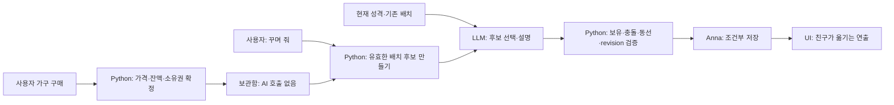

# 나만의 홈 · AI 성격 기반 꾸미기 기획

배포 상태: **1.4.3 / 도구 0.9.1 / working revision 57**. 승인된 픽셀 시제품을 실제 홈에 연결했다. [배포 기록](../releases/RELEASE_143.md) · [개인 스프라이트 안내](HOME_PIXEL_ART.md).

## 확정된 새 방향 · 2026-10-16

사용자는 기존 홈이 좁고 게임 공간처럼 느껴지지 않는다고 지적했다. 집과 마당을 선택했고, 직접 올린 2D 탑다운 농장 게임 화면을 시점·픽셀 표현·공간 비율의 기준으로 확정했다. 농사 기능 도입 요청은 아니다. 기존 던전의 표현은 품질 기준에서 제외한다.

- 지붕이 있는 집 외관과 넓은 마당이 하나의 타일 맵을 이룬다. 문을 지나면 별도의 실내로 전환한다.
- 캐릭터는 초상화를 통째로 흔드는 방식 대신, 방향과 동작별 자세가 다른 스프라이트를 사용한다.
- 배경·가구·캐릭터의 픽셀 크기와 시점을 맞춘다. 발/몸이 바닥에 붙고 물체 뒤에서는 가려지며 걷기와 정지가 자연스럽게 이어져야 한다.
- 공간이 화면의 중심이다. 실제 기능 연결 시 가구 상점은 요청 시 열고, 카메라 이동·확대/축소를 제공한다. 캐릭터는 자동 이동한다.
- 사용자 구매·친구 배치·명시적 꾸미기에서만 AI 1회·Python 권위 검증 원칙을 유지한다.

[움직이는 시제품과 실행 안내](../../prototypes/pixel-home/README.md): 원본 예시 친구의 네 방향 16프레임, 분리된 집/나무/가구, 발밑 충돌·깊이 가림, 자동 실내외 왕복, 확대/축소·정지를 확인한다. 실제 저장·가구 구매·사용자 캐릭터 변환은 연결하지 않았다. 참조 이미지의 미술 품질을 완성했다고 주장하지 않으며, 시제품을 보고 아트 밀도와 동작을 먼저 조정한다.

1.4.2 통합은 [개인 스프라이트 안내](HOME_PIXEL_ART.md)에 따라 현재 친구 원본을 참조하는 이미지 생성, 16프레임 검증, 사용자별 저장과 저장 전용 재시도를 구현했다. 1.4.3부터 새 친구·새 초상화 저장 시에만 동작을 준비하고 홈과 던전에서 공유하며 수동 생성 버튼은 제거했다. 기존 초상화에 필터만 적용해 방향별 스프라이트를 얻을 수 있다고 가정하지 않는다. 실서비스의 배치/동선 규칙은 Python 코어를 확장하며, UI는 승인된 경로를 재생한다.

이하 내용은 **1.4.0 최초 기획과 구현 이력**이다. 손그림 미니어처 방·초상화 이동·고정 방 1개 등 시각적 범위는 위 새 방향으로 대체된다.

## 제품 방향과 버전 원칙

사용자는 가구를 구매하고, 친구는 자신의 성격으로 방을 꾸미며 그 안에서 생활한다. 수동 배치 편집기가 아니라 ‘함께 사는 친구의 취향을 발견하는 공간’으로 만든다.

- 사용자 지시(2026-10-16): 버전을 빠르게 올리지 않고 충분히 검증한 묶음으로 출시한다. **이 기능의 완성 목표는 1.4.x 이내**로 잡는다.
- 기획·아트 검증·내부 프로토타입 동안 1.2.1을 유지했고 완성 묶음으로 1.4.0을 배포했다. 아래 작업 단계를 완료할 때마다 앱 버전을 올리지 않는다.
- 1.3.x는 기반 정비가 실제 배포할 가치가 있고 사용자가 요청할 때만 사용한다. 홈 기능을 위해 중간 버전을 억지로 만들지 않는다.
- 첫 홈 공개 후보는 **1.4.0**, 실사용 개선은 필요한 만큼 **1.4.x**에서 다룬다. 1.5 이상으로 범위를 늘려 해결하지 않고 1차 범위를 줄인다.
- 실제 버전 확정·테스트 앱 배포·심사 제출은 별도 구현/출시 작업에서 결정한다. 기존 심사 후보 1.0.0과 개인 데이터를 보존한다.

## 1. 경험의 핵심

1. ‘홈’에서 방과 친구를 본다. 처음에는 기본 바닥·벽·휴식 자리만 제공한다.
2. ‘가구 상점’에서 모양·크기·가격·보유 상태를 확인하고 게임 코인으로 구매한다.
3. 구매는 즉시 소유권과 잔액에 반영한다. AI 호출 성공 여부와 구매 성공 여부를 분리한다.
4. 친구가 성격에 맞춰 배치안을 고른다. 검증된 배치만 저장한다.
5. 친구가 이동해 가구를 옮기고, 왜 그 자리를 골랐는지 한 문장으로 말한다.
6. 이후 방에서 책 보기·쉬기·식물 살펴보기 등 짧은 생활 모션을 한다.

사용자가 할 수 있는 일은 구매·‘꾸며 줘’ 요청·연출 건너뛰기·이전 배치로 되돌리기다. 드래그 배치·방향 지정·가구별 좌표 지시는 제공하지 않는다. 되돌리기는 과거의 검증된 방을 복원하는 기능이며 수동 편집이 아니다.

## 2. 시각 방향

**부드러운 손그림풍 2D 미니어처 방 + 기존 공책 JRPG UI**를 추천한다.

| 요소 | 기준 |
| --- | --- |
| 방 시점 | 바닥과 벽 두 면이 보이는 고정된 사선 시점. 카메라 회전 없음 |
| 색감 | 크림색 벽·따뜻한 나무·세이지 그린·은은한 황동. 과한 채도와 번쩍임 억제 |
| 표현 | 외곽선·광원·그림자 방향을 통일한 2D 가구 스프라이트. 과도한 입체 플라스틱 느낌 제외 |
| UI | 기존 Galmuri11 제목·공책 배경·갈색 이중 테두리·초록 버튼 공유 |
| 방과 캐릭터 | 캐릭터가 소품에 묻히지 않는 크기, 문과 이동 공간을 눈으로 알아볼 수 있는 구성 |
| 화면 | 데스크톱에는 방을 크게, 모바일에는 방 위/아래로 상점·상태 패널 배치. 작은 글자나 가로 넘침 금지 |

방 전체를 꾸밀 때마다 한 장의 AI 이미지로 다시 생성하지 않는다. **바닥·벽·가구·그림자·캐릭터를 분리해서 렌더링**해야 실제 이동, 가림, 클릭, 저장과 재접속이 가능하다. 예시 이미지는 분위기·시점·밀도 참고용이며 타일/애니메이션 자산이나 실제 구현 화면이 아니다.

첫 시안은 용용이의 ‘다정한 학자’ 성격으로, 창가의 독서 공간과 넉넉한 휴식 자리를 표현한다. 개인 계정 캐릭터를 참조한 예시는 로컬 `.local/`에만 보관하며 공개 저장소·Anna 번들에 넣지 않는다.

## 3. 성격이 배치에 영향을 주는 방법

기존 `personality.view()`의 호기심·다정함·활동성·신중함 값을 활용한다. 별도 성격을 덮어쓰거나 가구 구매로 능력치를 임의 증가시키지 않는다.

| 축 | 배치에 반영할 선호 | 생활/꾸미기 연출 |
| --- | --- | --- |
| 호기심 | 새 물건의 가시성, 책·수집품의 접근성, 작은 전시 공간 | 새 물건을 살펴보고 주변을 돌기 |
| 다정함 | 휴식 자리와 테이블의 근접, 따뜻한 조명, 아늑한 소규모 묶음 | 쿠션을 정돈하고 사용자 쪽을 바라보기 |
| 활동성 | 넓은 중앙 통로, 가구 사이 이동 여유, 활동 영역 확보 | 여러 구역을 오가며 가구 이용 |
| 신중함 | 기존 배치 유지, 벽면 정돈, 출입구와 휴식 자리의 안정적 접근 | 잠깐 살펴본 뒤 천천히 옮기기 |

성격은 여러 축의 조합이다. ‘호기심이 높으면 무조건 어지럽다’ 같은 단정이나 벌칙을 만들지 않는다. 현재 성격 스냅샷과 사용자가 산 물건을 함께 고려하고, 가구의 외형을 AI가 바꾸지는 않는다.

같은 친구는 비슷한 조건에서 일관된 취향을 보여야 한다. 매 접속·매 돌봄에 방을 재배치하지 않고 **사용자의 명시적인 ‘꾸며 줘’ 요청**에서만 실행한다. 점진적인 성격 변화는 다음 요청 때 반영한다.

## 4. ‘사용자 구매, AI 배치’를 지키는 구조

- **권장 1차 방식:** 엔진이 최대 4개의 유효한 후보를 만들고, AI는 후보 ID와 짧은 이유만 선택한다. 자유 좌표 JSON부터 시작하지 않는다. 성격별로 의미 있게 다른 후보를 마련한다.
- 후보에는 가구별 좌표·허용 방향·보관 여부·재배치할 가구·운반 경로가 포함된다. 후보 수와 최종 제안 수는 성능 검증 후 확정한다.
- LLM은 가격·보유 수량·방 크기·전투 수치·이동 가능 여부·후보에 없는 새 가구를 결정할 수 없다. 응답은 엄격한 스키마·길이 제한으로 검증한다.
- 가구 이름/설명과 사용자 텍스트는 데이터로 취급한다. 배치 선택 요청에는 불필요한 전체 대화나 원본 개인 사진을 보내지 않는다.
- AI 실패·거부·오류 시 가구 구매는 취소하거나 중복 결제하지 않는다. 새 가구는 보관함에 두고 기존 방을 유지하며 재시도 버튼을 제공한다.
- **AI 전담 원칙:** AI가 선택하지 못했는데 규칙 기반 배치를 몰래 적용한 뒤 ‘친구가 골랐다’고 표시하지 않는다. 첫 방의 기본 구조만 미리 정한 시작 상태다.
- 새 유료 모델 호출은 명시적인 꾸미기 요청에서만 한다. 접속·애니메이션 재생·저장 재시도 때 호출하지 않는다. 기존 Anna LLM 경로를 사용하며 이미지 편집 API를 전제하지 않는다.

## 5. 엔진이 보장할 배치 규칙

논리 좌표는 숨겨진 격자로 관리하고 화면에서만 사선으로 투영한다. 초안은 방 10×8칸이며 실제 크기는 시안/모바일 검증 후 결정한다.

- 가구마다 `catalog_id`, 가격, `footprint`, 바닥/벽/소품 레이어, 허용 방향, 접근 지점, 태그를 정적 데이터로 정의한다.
- 사용자 보유 인스턴스만 배치할 수 있고 같은 인스턴스를 두 곳에 쓸 수 없다. 1차는 카탈로그별 최대 1개로 단순화한다.
- 방 경계·출입구·창·고정 시설을 침범하지 않고, 바닥 가구끼리 겹치지 않는다. 벽걸이는 별도 벽 슬롯으로 검사한다.
- 캐릭터 크기를 고려한 문→휴식 자리→상호작용 지점 경로를 확보한다. 거대한 친구를 작은 캐릭터처럼 검사하지 않는다.
- 가구를 **옮기는 도중**에도 충돌을 검사한다. 캐릭터가 지나갈 수 있어도 운반 중 가구가 벽을 뚫으면 그 계획은 허용하지 않는다.
- 해결할 수 없는 순환 이동은 유효한 임시 보관 동작이 있을 때만 허용한다. 1차에서는 새 가구 최대 3개의 추가 또는 기존 바닥 가구 1개의 이동으로 제한한다.
- 공간이 부족하면 보관함에 남긴 이유를 설명한다. 사용자의 물건을 버리거나 판매하지 않는다. 가구를 못 놓는다고 성격/친밀도 벌점을 주지 않는다.

## 6. 이동 연출과 캐릭터 정체성

기존 던전은 사용자 초상화의 도트 파생본을 변형해 이동을 표현한다. 이는 정교한 방향별 보행 스프라이트가 아니다. 홈의 고품질 2D에서 같은 품질을 보장한다고 가정하지 않는다.

| 단계 | 연출 |
| --- | --- |
| 선택 | 가구를 바라보고 짧게 고민하기 |
| 접근 | 검증된 경로를 따라 이동, 이동 방향에 맞춰 시선/몸 기울기 변경 |
| 운반 | 작은 가구를 밀거나 마법으로 띄워 함께 움직이기 |
| 설치 | 제자리에 내려놓고 그림자·먼지/빛 효과를 짧게 표시 |
| 마무리 | 한 걸음 물러서 확인하고 성격에 맞는 한 문장 말하기 |

- 공통 기본은 **몸통 전체의 부드러운 이동·기울기·상하 움직임 + 약한 마법 운반 효과**로 한다. 손·다리 없는 친구에게 새 팔다리를 만들지 않는다.
- 실제 손/발을 사용하는 운반은 해당 캐릭터에 적합한 별도 자산이 검증됐을 때만 확장한다. 용용이는 기어가거나 미끄러지듯 이동하고 마법으로 운반한다.
- 첫 검증에서 기존 그림을 억지로 좌우 반전·찌그러뜨렸을 때 어색하면 해당 모션을 줄인다. 정면 그림 하나에서 완전한 뒷모습을 생성한 것처럼 주장하지 않는다.
- 1회 꾸미기는 약 10~20초를 목표로 하고, 즉시 보기와 동작 줄이기를 제공한다. 프레임마다 서버 저장하거나 LLM을 부르지 않는다.
- 생성된 시안에서 보이는 자세를 실제 연속 모션으로 구현하려면 분리 자산·프레임 정렬·가림·접지 그림자 검수가 필요하다.

## 7. 저장·구매·되돌리기

- 코인 차감과 가구 소유권은 기존 Python 게임 저장의 **같은 조건부 커밋**에서 처리한다. 검증되지 않은 별도 브라우저 잔액을 두지 않는다. 요청 ID 재시도로 중복 차감을 막는다.
- 홈 상태는 `schema_version`, 방 ID, 보유 가구 인스턴스, 확정 배치, 이전 배치 1개, 배치 revision, 마지막 꾸미기 요청 영수증, 연출 정보로 구성한다. 정확한 필드와 기존 세이브 마이그레이션은 구현 전에 확정한다.
- 기존 펫·대화·그림·장착 정보는 보존한다. 홈의 초기 값은 기존 세이브를 읽을 수 있게 추가하고, 단순 조회만으로 마이그레이션을 저장하지 않는다.
- AI 요청 시작 시의 pet_id·홈 revision·가구 보유 상태를 저장하고, 완료 시 바뀌었다면 재검증한다. 다른 창에서 새 친구로 교체됐는데 옛 친구의 배치를 저장하지 않는다.
- 최종 배치와 작업 영수증을 먼저 저장한 뒤 UI가 이동을 보여준다. 중간 연출은 권위 있는 좌표 변경이 아니다. 도중에 창을 닫으면 재접속 시 확정된 방을 읽으며 AI/구매를 반복하지 않는다.
- ‘이전 배치’는 직전의 유효한 배치 1개를 복원한다. 구매를 환불하거나 물건을 복제하지 않는다. 새로 산 물건이 과거 배치에 없으면 보관함에 남는다. 되돌리기도 revision과 현재 소유권을 검사한다.
- 기존 리셋/개인정보 삭제 경로에 홈 상태를 포함한다. 사용자별 생성 자산을 도입하기 전에는 홈의 공용 정적 자산을 개인 파일처럼 삭제하지 않는다.

## 8. 첫 구현 범위와 제외 범위

목표는 방 1개, 기본 테마 1개, 가구 12종, 게임 코인 구매, 성격 기반 AI 배치, 이동 연출, 이전 배치 1회 복원이다. 가구 가격과 코인 소모 속도는 현재 보상/잔액 분포를 확인해 정하며 실결제는 넣지 않는다.

가구 후보: 휴식 둥지, 책장, 낮은 책상, 독서등, 책 수레, 둥근 러그, 쿠션, 화분, 벽 그림, 커튼, 찻잔 세트, 수납 바구니. 그림·소품의 배치 레이어는 실제 시안에 맞춰 정한다. 첫 입주 시 기본 휴식 자리를 무료 제공해 구매 전에도 방이 비어 보이지 않게 한다.

1차에서 제외: 여러 층/여러 방, 자유 건축, 수동 배치, 가구 자유 회전, 상점 판매/환불, 방문/멀티플레이, 실결제, 가구 합성, 실시간 생성 가구, 개별 캐릭터 완전한 8방향 애니메이션. 가구 보유는 기존 외형 아이템 도감과 별도 카탈로그로 구분한다.

## 9. 구현 순서와 통과 조건

아래는 **내부 작업 단계**이며 단계마다 버전을 발행하지 않는다.

| 단계 | 산출물 | 다음 단계로 넘어갈 조건 |
| --- | --- | --- |
| A. 시각/동작 검증 | 방 시안 1장, 실제 분리 가구 3종, 캐릭터 이동 실험 | 모바일에서 잘 보이고 가구/캐릭터가 따로 논다는 느낌이 적음. 다리가 없는 친구도 자연스럽게 운반 |
| B. 순수 코어 | 가구 데이터·구매·소유권·배치 후보·동선 검증·복원 | 음수 잔액/중복 지급/충돌/출입구 차단/부활 문제 없음. 파일 I/O 없는 코어 검사 통과 |
| C. Anna 연결 | 조건부 저장·영수증·LLM 선택·오류/재시도 UI | 중복 구매 방지, 저장 충돌 보호, AI 오류 시 방 보존, 기존 세이브 회귀 통과 |
| D. 방 생활/꾸미기 | 12종 가구와 이동·설치·생활 모션 | 운반 중 가구 겹침/벽 통과 없음. 취소/재접속/동작 줄이기·성능 검증 통과 |
| E. 1.4.0 후보 검증 | 실제 Windows/Linux 도구+UI 테스트 설치 | 기존 펫/그림/대화 보존, 두 실행기 도구 버전·설치 UI 확인, 제한 기록 완료 |
| F. 1.4.x 개선 | 실사용 문제를 묶어 수정 | 꾸밈 취향·가격·경로·모바일 품질을 검증. 범위 확대보다 완성도 우선 |

검사 항목: 성격만 다른 동일 보유 가구의 후보 비교, 성격 설명과 실제 배치의 일치, 반복 요청의 과도한 재배치 방지, 잔액 부족·중복 클릭, AI/저장 실패, 여러 창 충돌, 리셋 중 늦은 응답, 초기화/삭제/되돌리기, 창 종료 후 복구, 큰 몸/손 없는 캐릭터, 모바일·키보드·모션 줄이기.

## 10. 기술 선택과 남은 결정

초기 프로토타입은 기존 Canvas 2D 렌더링 경험을 재사용한다. 가구 수·가림·광원·터치 처리에서 복잡성이 실제로 커지면 PixiJS를 검토한다. 지금 계획만으로 새 렌더링 프레임워크를 의존성에 추가하지 않는다. [PixiJS 장면 객체](https://pixijs.com/8.x/guides/components/scene-objects).

구현 전에 확인할 사항은 실제 분리 자산의 시각 품질, 캐릭터 크기별 최소 통로, 가구 가격, 대표 배치 후보 수, 홈 화면 진입 위치다. 첫 시안으로 미술 방향을 확인한 뒤 A단계의 작은 움직이는 장면으로 품질을 검증한다. **이미지 편집 API를 기다릴 필요는 없지만, 컨셉 그림 한 장이 곧 플레이 가능한 방은 아니다.**

## 1.4.0 구현 범위

- 분리된 Canvas 바닥·벽·창문과 12종 투명 가구, 기존 친구 초상화를 사용한다. 방 전체를 이미지로 생성하지 않는다.
- 무료 둥지와 11종 구매 가구, 보관함, 1회 최대 3개 배치, 이전 배치 복원. 수동 배치는 없다.
- Python이 소유권·가격·잔액·충돌·출입구·2×2 이동 경로를 검증하고 최대 4개 후보를 제공한다. LLM은 저장된 성격을 보고 후보 하나와 짧은 이유만 선택한다.
- ‘꾸며 줘’ 한 번에 AI 최대 1회, 응답 최대 160토큰. 구매 직후 자동 호출하지 않는다. 보기·이동·생활·되돌리기·저장 확인은 0회다.
- 실제 방향별 걷기 스프라이트 대신 기존 초상화의 이동·기울기·운반 효과를 사용한다. 독서·급수 등 별도 행동 스프라이트와 넓은 방·추가 가구는 포함하지 않는다.
- 기존 데이터는 읽기만으로 변경하지 않고 첫 구매/배치 때 선택적인 home v1을 저장한다. 재시도는 기존 요청 ID로 저장 결과만 확인한다.
