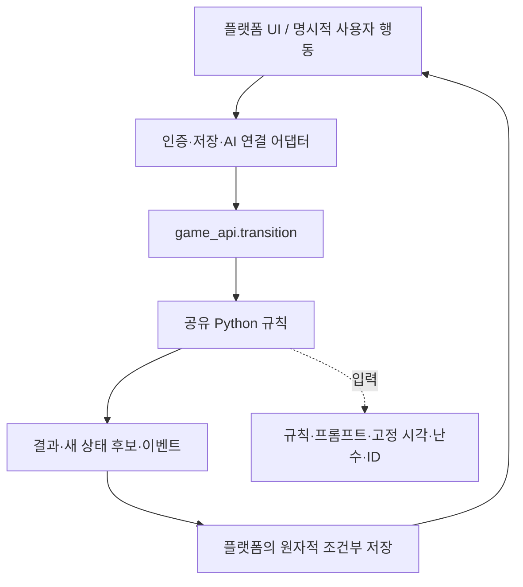

# 공통 코어와 플랫폼 확장

> 웹 후속 구현: [GitHub Pages 프리뷰](../web/README.md). `release-web`에서 정적 배포하며, Pyodide module worker·IndexedDB revision/CAS·JSON 백업·Gemini BYOK 단일 턴 대화를 제공한다. 아래의 1단계 설명은 당시 완료 범위이며 현재 웹 구현 범위/제한은 웹 안내를 따른다.

2026-10-15 사용자 선언을 기준으로 한다. 노트버디는 JRPG 노트 테마의 AI 펫 육성·던전 게임이며, Python 규칙 엔진이 재화·능력치·타이머·전투·보상을 결정한다. LLM은 페르소나와 표현을 담당하며 임의로 게임 상태를 변경하지 않는다.

## 소스와 배포 트랙

- `main`: 공통 코어와 어댑터를 통합·검증하는 기준 소스. 코어의 의존성 그래프에 플랫폼 저장·네트워크·환경변수를 넣지 않는다.
- 기존 `release`: Anna 배포를 계속하는 트랙. 이름 변경 없이 유지하고 검증한 공통 변경을 반영한다.
- 향후 `release-web`: 정적 웹 빌드가 준비될 때 생성한다. Pyodide·IndexedDB·BYOK 어댑터를 사용한다.
- 향후 `release-android`: 웹 빌드와 코어를 재사용하는 Android 패키징이 준비될 때 생성한다.

브랜치별로 게임 규칙을 복사하거나 각각 수정하지 않는다. 이번 1단계에는 기존 앱 소스를 지우거나 웹·Android 출시를 완료한 것으로 취급하지 않는다. 코어 CI는 `main`, Anna 배포 패키지 CI는 `release` 푸시에서 실행한다.



## 1단계 구현

| 경로 | 역할 |
| --- | --- |
| `engine/game_api.py` | 파일 없이 상태를 입력·출력하는 `transition`, 저장 포트를 사용하는 `GameApplication` |
| `engine/ports.py` | `ExecutionContext`, `StateRepository`, `Snapshot`, 실행별 의존성 바인딩 |
| `engine/domain.py` | 플랫폼과 무관한 오류·사용자 슬롯 검증·KST 기준 |
| `engine/engine.py` 및 규칙 모듈 | 기존 성장·행동·탐험·수집 규칙의 단일 구현 |
| `engine/local_runtime.py`, `engine/runtime.py` | 기존 CLI·파일 저장·접근 제어·OS 잠금·환경변수 호환 어댑터 |
| `engine/repositories.py` | 메모리 저장과 파일 저장의 최초 생성·revision 조건부 쓰기 구현 |
| `anna/executas/notebuddy/game_worker.py` | Anna 인증 저장에서 받은 JSON을 직접 공통 코어로 전달하고 UI 뷰 생성 |

`engine`와 `art`의 기존 직접 호출은 호환을 위해 필요할 때만 로컬 어댑터를 불러온다. 이 경로를 Web에서 사용하지 않는다. 이식 대상 진입점은 `game_api.transition`이며 `ExecutionContext`를 반드시 제공한다. 데이터와 프롬프트도 호스트에서 전달하므로 코어 import 시 파일을 읽지 않는다.

```python
from game_api import transition
from ports import ExecutionContext

# rules/templates는 호스트가 읽거나 정적 자산에서 전달한다.
context = ExecutionContext(rules, templates, now, rng, new_id)
candidate = transition(saved_state, "feed", context, request_id="stable-request")
# candidate.changed가 참이면 플랫폼이 상태+영수증을 함께 저장한다.
# 저장 성공 전에는 사용자에게 최종 성공을 확정하지 않는다.
```

한 실행의 시각은 고정하며 난수와 식별자는 주입한다. 입력 상태를 복제하고, 읽기·응답 재시도만으로 마이그레이션을 저장하지 않는다. 오류는 기존 상태를 보존한다. 관리자 리셋·소유주 설정·다중 사용자 순위는 순수 진입점에서 허용하지 않고 로컬 어댑터가 담당한다.

## 저장 계약

`load(actor_id)`는 상태와 revision을 반환한다. `compare_and_set(actor_id, revision, state)`는 현재 revision과 일치할 때만 상태를 원자적으로 교체한다. revision이 `None`이면 이미 없는 행을 원자적으로 생성하는 요청이다. 충돌은 `False`, 실제 저장 장애는 예외로 구분한다. `GameApplication`은 제한된 재조회·재계산 후 저장 성공을 확인하고 결과를 반환한다. 보상과 처리 영수증은 같은 상태에 저장한다.

Anna는 기존 APS·bounded receipt·삭제·리셋 계약을 유지한다. 코어는 메모리 후보를 계산하고 기존 `GameService`가 APS ETag로 최종 커밋한다. APS의 원자적 최초 생성 미지원은 [기존 제한](../anna/docs/FIRST_CREATION.md)으로 남으며 새 인터페이스가 이 플랫폼 제약을 해결했다고 주장하지 않는다.

## 검증

- `python -B -X utf8 -m unittest discover -s tests -p "test_*.py"`: 기존 엔진 회귀와 순수 import·파일/시계 차단·CLI 결과 대조·CAS 계약 검사.
- `npm run test:plugin` (`anna/`): 임시 저장 파일과 환경변수 변경이 없는 작업자, APS 보상·재시도·삭제·리셋·사용자 격리.
- `npm ci --prefix tests/pyodide --ignore-scripts`, `npm test --prefix tests/pyodide`: 실제 브라우저 Pyodide에서 동일 코어의 탄생·돌봄·상태·최종 보상·재시도 검사. Windows는 설치된 Edge, Linux는 `tests/pyodide`에서 `npx playwright-core install chromium`으로 준비한다.

Pyodide 검사는 순수 Python 소스 9개만 가상 실행 공간에 제공하며 규칙·프롬프트는 JS에서 값으로 주입한다. 로컬 파일 어댑터는 제공하지 않는다. 테스트 서버는 정적 파일 제공용으로 검사 중에만 실행된다. 사용자 데이터·계정·유료 AI는 사용하지 않는다. 검증 버전은 **Pyodide 314.0.7**이며 [공식 실행 안내](https://pyodide.org/en/stable/usage/quickstart.html)를 따른다.

## 다음 단계와 비용 목표

다음 단계는 Web Worker의 Pyodide 메시지 어댑터, IndexedDB의 원자적 최초 생성·조건부 쓰기, 저장 내보내기·가져오기, BYOK 제공자별 직접 호출이다. Android는 같은 웹 앱을 재사용하고 필요한 기기 기능만 연결한다.

운영자의 상시 게임 서버·DB·AI 중계 서버가 필요 없는 방향을 유지한다. 정적 호스팅의 무료 한도, 사용자 AI 사용료, 앱스토어 등록 비용은 별개다. 브라우저 직접 호출이 안 되는 AI 제공자는 서버를 임의로 추가하지 않고 지원 범위를 제한한다. 기기 간 자동 동기화와 서버 수준의 조작 방지는 기본 제공 범위가 아니다. API 키는 앱 공용 키로 배포하지 않는다.

이번 단계에서는 IndexedDB 저장, 실제 BYOK 호출, 서비스 워커 캐시, Android 패키징 및 공개 웹 배포를 구현하지 않았다.
