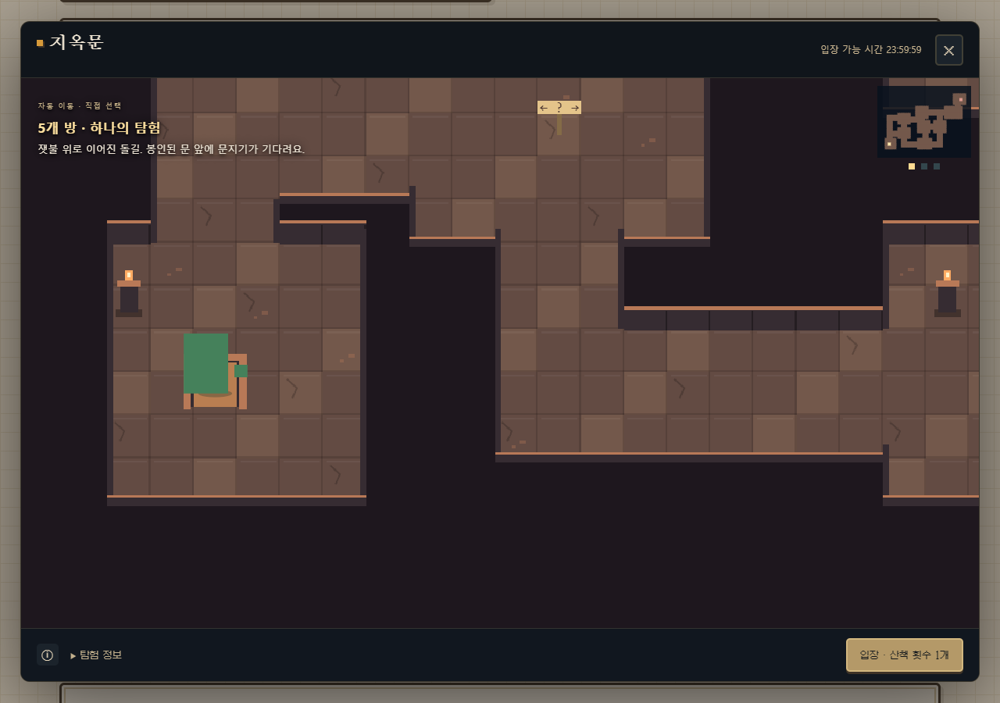

# NoteBuddy Web · 0.4.1

[웹에서 플레이](https://kdkrkwhr.github.io/notebook-pets/) · [이번 업데이트](RELEASE_041.md) · [이전 버전](RELEASE_040.md)

브라우저 안에서 친구를 돌보고, 산책하다 발견한 던전을 탐험하고, 집과 마당을 구경할 수 있어요. 게임은 이 브라우저에 저장돼요. Anna 계정과 자동으로 동기화되지는 않아요.

## 집과 마당, 같은 친구의 모험

상단 **◐ 테마**에서 기본 공책·고요한 밤과 다섯 던전의 분위기를 고를 수 있어요. 즉시 미리 보고, 다음 실행에도 이 브라우저에서 기억해요. 테마 선택은 AI를 쓰지 않으며 친구·그림·재화를 바꾸지 않아요. Anna와 같은 테마 코드와 화면을 사용하지만, 각 기기의 선택은 별도로 저장돼요.

**나의 홈**을 열면 친구가 마당과 집 안을 오가요. 방향에 맞는 픽셀 동작과 카메라, 가구 뒤로 가려지는 표현은 Anna와 같은 화면 코드를 사용해요. 던전에서도 같은 친구의 동작을 불러와요.


코인으로 가구를 구입하고 **꾸며 줘**를 누르면 친구가 자신의 성격에 맞춰 배치를 골라요. 구매만으로 자동 배치되지는 않아요. 이전 배치로 되돌릴 수도 있어요. 배치 가능한 위치와 돈·소유권·통로는 공통 Python 규칙이 검사해요.



위 화면은 테스트 공책과 공개 프로토타입 캐릭터로 검증한 예시예요. 사용자의 친구는 자신의 그림을 참고해 동작을 만들며, 이 예시 캐릭터를 모든 사용자에게 넣지 않아요.

## 내 그림과 픽셀 동작

1. **설정**에서 Gemini API 키와 이미지 생성 모델을 입력해요. 기본 이미지 모델 ID는 `gemini-2.5-flash-image`이며, 계정에서 이미지 생성 권한과 할당량이 있어야 해요.
2. 키가 입력된 상태에서 새 친구를 만나면 기본 친구 그림으로 방향별 동작을 한 번 준비해요.
3. **새 그림 저장**에서 완성된 PNG·JPEG·WebP 캐릭터 그림을 선택하고 미리보기를 확인해요. 현재 성장 단계의 그림으로 저장하고, 그 그림을 참고해 새 동작을 한 번 만들어요. 종족·능력치·성격을 다시 분석하거나 바꾸지는 않아요.
4. 이후 홈·던전 입장과 이동은 저장된 동작을 사용해요. 동일한 그림의 재저장, 성장 단계 숫자만 변경, 새로고침은 이미지 AI를 호출하지 않아요.

키가 없으면 기본 게임과 그림 저장은 가능하지만 개인 동작은 만들지 않아요. 나중에 키를 입력해도 자동으로 과거 그림을 생성하지 않아요. 다음 새 그림을 저장할 때 적용돼요. 수동 동작 생성/재생성 버튼은 없어요. 이미 받은 동작을 저장하는 데 실패했다면 홈의 **동작 저장 다시 시도**로 같은 결과만 저장해요. 이 복구는 해당 탭에 받은 결과가 남아 있을 때 가능해요.

그림과 동작은 IndexedDB에 저장돼요. **공책 보관 → 백업 내려받기**에 함께 포함돼 다른 기기로 가져갈 수 있어요. 예전 0.3.0 백업도 지원해요. 예전 백업에는 그림이 없으므로 가져오기 시 기본 그림을 사용해요. 초기화는 게임과 해당 공책의 그림을 함께 비워요.

## AI 사용과 현재 범위

- 키는 현재 탭의 입력 필드에만 있으며 저장소·백업·URL에 넣지 않아요. 새로고침·초기화·백업 교체 시 지워져요.
- 대화, 명시적인 **꾸며 줘**, 새 캐릭터/새 그림의 동작 준비만 Google API를 직접 호출해요. 사용자 키의 요금·할당량을 사용해요. 그림 생성 시 참고 그림도 Google에 전달돼요. [공식 이미지 API 문서](https://ai.google.dev/gemini-api/docs/generate-content/image-generation).
- 홈 열기·구매·이동·던전 입장·되돌리기·저장 재시도에는 AI를 쓰지 않아요. 실패한 생성은 자동으로 재요청하지 않아요.
- AI 응답은 보상·능력치·타이머를 결정하지 않아요. 꾸미기는 제공된 후보 하나만 선택하고 코어가 검증해요.
- 탄생·육성·산책 선택·전투·발견 던전·퀘스트·24종 아이템 도감·가구·성장 앨범·수동 백업·단일 턴 대화를 지원해요. 대화는 현재 탭에서만 보여요.
- Anna의 그림 분석 후 탄생, AI 초상화/진화 그림 생성, 대화 영속화까지 전부 이식한 것은 아니에요. 웹의 새 그림은 사용자가 완성된 파일을 저장하는 방식이에요. 아바타 착용·PWA·Android는 아직 없어요.
- 실제 유료 Gemini 생성은 이번 검증에서 실행하지 않았어요. 테스트는 실제 Pyodide/저장소/화면과 모의 AI 응답을 사용해요. 모델이 캐릭터를 닮게 그렸는지와 방향별 자세의 품질은 실제 출력에서 확인해야 해요.

## 개발과 배포

```powershell
npm ci --prefix tests/pyodide --ignore-scripts
python web/build.py
node tests/pyodide/web.mjs
node tests/pyodide/web-world.mjs
python -m http.server 8080 --directory web/dist
```

`http://localhost:8080/`에서 실행해요. `file://`은 지원하지 않아요. 최초 실행에는 Pyodide 런타임을 내려받아야 해요.

`release-web`은 공유 소스 통합·코어 검증·Pages 배포 트랙이며, `.github/workflows/web.yml`이 빌드와 두 브라우저 검증을 통과한 결과를 배포해요. Anna `release`의 변경은 Git 병합으로 가져왔으며, Python 규칙을 별도로 복제하지 않아요. `engine/game_api.py`와 명시적인 `ExecutionContext`를 사용해요.

게임 서버·클라우드 DB·AI 프록시 없이 IndexedDB와 브라우저 직접 BYOK 요청을 사용해요. 코어 11개 Python 모듈과 공개 규칙, 공유 UI·폰트·공개 아트·고정 버전 Pyodide만 정적 배포에 포함돼요. Anna 계정의 개인 그림·저장 데이터·키는 포함하지 않아요. 웹 작업은 Anna의 설치 앱·도구·심사 후보를 재배포하지 않아요.

게임 revision은 증가만 하며, 초기화/백업 교체는 별도 epoch로 늦은 이미지 쓰기도 차단해요. 게임과 그림 교체는 한 IndexedDB 트랜잭션으로 처리해요. 시간은 기기 시계를 따르며 동기화 서버는 없어요.
