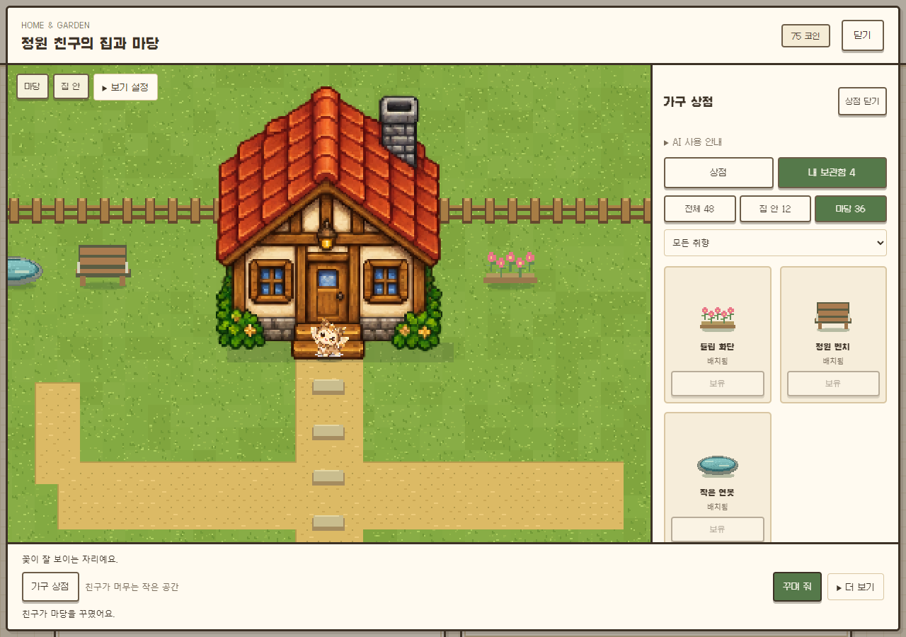

# NoteBuddy Web · 0.6.0

[웹에서 플레이](https://kdkrkwhr.github.io/notebook-pets/) · [이번 업데이트](RELEASE_060.md) · [로컬 AI 설정](LOCAL_AI.md)

브라우저에서 친구를 돌보고, 산책과 다섯 던전을 탐험하고, 집과 마당을 꾸밀 수 있어요. 게임·그림·배치·산책 이야기는 이 브라우저의 IndexedDB에 저장해요. Anna 계정과 자동 동기화되지는 않아요.

## 집과 마당

처음 마당에는 집·잔디·길·울타리만 있어요. 별도로 배치된 나무나 장식은 없어요. 실내 물건 12종과 정원 물건 36종 중 취향에 맞는 것을 고를 수 있어요.

**상점 / 내 보관함**에서 구매·배치 상태를 확인하고, **꾸며 줘**로 친구에게 배치를 맡겨요. 구매만으로 자동 배치하거나 AI를 호출하지 않아요. 코인·소유권·통로·배치 가능한 위치는 공통 Python 규칙이 검사해요. 이전 배치로 되돌려도 구매한 물건은 남아요.

PC에서는 풍경 옆에, 모바일에서는 풍경 아래에 상점이 열려요. 확대·일시정지는 **보기 설정**, 이전 배치·바로 보기는 **더 보기**에 모았어요. 부가 설명은 안내 아이콘을 가리키거나 누르면 보여요.



[모바일 화면](docs/home-mobile.png) · [던전에서 같은 픽셀 친구 사용](docs/dungeon-sprite.png). 모두 별도 테스트 공책으로 촬영했어요.

## 친구 그림과 첫 홈 선택

새 친구를 만나거나 **새 그림 저장**에서 PNG·JPEG·WebP 파일을 저장해도 이미지 AI를 바로 호출하지 않아요. 그 모습으로 마이홈에 처음 들어가면 다음 중 선택해요.

- **픽셀 캐릭터 생성**: 설정한 Gemini 또는 ComfyUI에 현재 그림을 보내 방향별 동작 시트 한 장을 요청해요.
- **기본 이미지 사용**: 현재 그림을 무료로 픽셀 변환해 저장해요. 방향별 동작은 만들지 않아요.

저장한 모습은 홈과 던전에서 함께 사용해요. 재접속·이동·성장 단계 숫자 변경·동일 그림 재저장은 이미지 AI를 호출하지 않아요. 새 그림에는 새 첫 선택이 제공돼요. 생성에 실패하면 무료 기본 모습을 사용하며 자동 재요청하지 않아요. 받은 이미지의 저장만 실패하면 **동작 저장 다시 시도**로 같은 결과를 저장해요.

웹의 **새 그림 저장**은 사용자가 완성한 파일을 가져오는 기능이에요. Anna의 그림 분석 후 탄생과 AI 초상화 생성까지 이식한 것은 아니에요.

## 돌봄과 산책

채팅 위 **돌봄·행동 AI 반응**을 끄면 행동·상태·보상만 처리해요. 산책은 기본 이야기와 선택지로 이어지며 AI 이야기는 생성하지 않아요. 직접 보내는 채팅은 선택한 AI를 사용해요. 이미 보낸 요청은 완료될 수 있어요.

옵션을 켜고 대화 AI를 설정하면 완료한 돌봄에 짧은 반응을 받으며, 조용한 산책에서 AI 이야기를 요청해요. AI가 실패해도 이미 저장한 행동·보상은 유지되고 기본 산책을 끝낼 수 있어요. 산책 선택과 결과를 확인한 뒤 새 던전 카드가 나타나요. 재접속·산책 이어보기는 AI를 다시 요청하지 않아요.

대화·돌봄 반응은 현재 탭에서 보여요. 최근 산책 이야기는 저장하며 백업에도 포함돼요.

## AI 설정과 저장

- **설정**에서 대화·배치는 Gemini/Ollama, 이미지는 Gemini/ComfyUI를 선택해요. 로컬 제공자만 선택하면 Gemini 키 없이 사용할 수 있어요. AI 없이도 돌봄·탐험·무료 홈 모습을 이용할 수 있어요.
- 웹은 Anna 토큰을 쓰지 않아요. Gemini는 개인 키의 요금·할당량을 사용하고, Ollama/ComfyUI는 설정한 로컬 서버에 직접 요청해요. 로컬 실패 시 Google로 전환하지 않아요.
- API 키와 ComfyUI 워크플로 파일은 현재 탭에서만 사용해요. 저장소·백업·URL에는 넣지 않아요. 모델·서버 주소 같은 연결 설정만 이 브라우저에 기억해요.
- **공책 보관**에서 게임·그림·동작·산책 기록을 백업하고 다른 기기로 가져올 수 있어요. 예전 형식의 백업도 지원해요. 가져오기와 초기화는 확인 후 실행하고 늦게 도착한 AI 응답이 이전 친구를 되살리지 못하도록 차단해요.
- AI가 보상·능력치·타이머를 결정하지 않아요. 장비 착용·PWA·Android는 아직 지원하지 않아요.

## 개발과 검증

```powershell
npm ci --prefix tests/pyodide --ignore-scripts
python web/build.py
node tests/pyodide/web.mjs
node tests/pyodide/web-world.mjs
node tests/pyodide/web-current.mjs
node tests/pyodide/web-themes.mjs
python -m http.server 8080 --directory web/dist
```

공통 규칙은 `engine/game_api.py`와 명시적인 `ExecutionContext`로 실행하며, UI·이미지 판독·산책 이야기는 Anna의 공유 모듈을 사용해요. 웹 어댑터는 IndexedDB 저장과 브라우저 직접 AI 요청을 담당해요. 서버·DB·AI 프록시 없이 GitHub Pages에 배포해요.

검사는 실제 Pyodide·IndexedDB·브라우저와 모의 AI 응답을 사용해요. 이번 업데이트에서 실제 유료 AI 생성 품질은 추가 검증하지 않았어요. 공개 배포에는 코드·공개 아트·폰트·Pyodide만 포함되며 개인 그림·키·저장 데이터는 포함하지 않아요.
